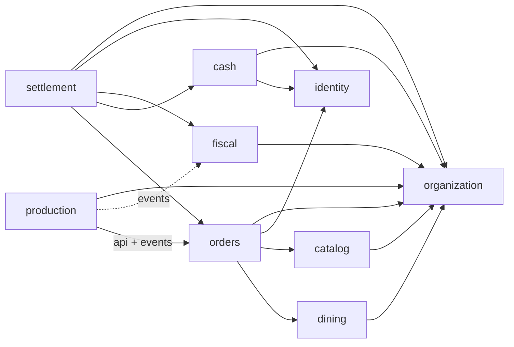

# restaurantPRO backend — R2 decisions for approval (spec Stage 2)

Status: **ACCEPTED** by Xavier Francisco, 2026-11-04 ("aprovado"), including all recommendations P7–P21 and B4–B5; approval also counts as G2 (PRD) and G3 (slices) for R2. It continues [backend-decisions.md](backend-decisions.md): D1–D33, P1–P6 and B1–B3 stay in force, and the ids here continue from D34, P7 and B4. Answer by id, for example "P9: prices are net". After approval, the decisions marked ★ become ADRs in `docs/adr/`.
Source of truth: [product_description.md](../product_description.md), cited as §n. The slices, contracts and graph are in [PRD R2](../prd/r2-stage2.md). The glossary is in [CONTEXT.md](../../CONTEXT.md), and the coding rules are in [backend-conventions.md](../architecture/backend-conventions.md).

---

## 0. Blockers and decisions that need you

**Blockers to *building* R2: none.** Every open market parameter sits behind a port that has a buildable default. Two items block the *launch*. Spec §5 and §14 #10 say that a fiscal integration the market requires is a launch condition, not a later phase:

| id | launch condition | what R2 delivers instead |
|---|---|---|
| B4 | A certified fiscal adapter for the chosen country (P7) | The `FiscalAdapter` port and the `internal` adapter. That adapter is **NOT FOR PRODUCTION**: the app refuses to start with it unless you set `restaurantpro.fiscal.allow-non-certified=true`, every printout carries "DOCUMENTO NÃO FISCAL", and the health endpoint reports `fiscal: NON_CERTIFIED` (D54). |
| B5 | Tests with the real printer models (§12 "testes com impressoras reais") | ESC/POS over TCP 9100, plus a TCP fake in tests (D57). |

**Product decisions.** I build R2 with these defaults unless you override them:

| id | question | recommendation (default) | rejected alternative / why |
|---|---|---|---|
| P7 | Country, fiscal regime and certification (§15). The country stays configurable (P1). | Do not pick a market in R2. The `internal` adapter is generic and non-certified (B4). Name the market before the pilot. Its adapter becomes its own run, and that run gates launch. | A guessed market (PT/SAF-T or MZ) would bake in rules the spec forbids assuming (§5). |
| P8 | Which documents R2 issues ("documentos exigidos no país", §13). | One generic document type, `SALE` (an invoice-receipt for a closed order). Its number comes from a per-store series. Corrective documents (credit notes) and fiscal exports wait for the market adapter or R3. | Modelling invoice, receipt and credit note now: their semantics depend on the regime, so we would guess and then rework. |
| P9 | Are catalog prices tax-inclusive? | **Yes, gross** (the usual practice for restaurant menus). Tax is split out per line: `net = round(gross / (1 + rate))` and `tax = gross − net` (D59). | Net prices: then the menu price printed on a receipt is not the price on the card. |
| P10 | Payment provider (§15). | No integrated provider. Methods are configuration data (D52): `CASH`, plus methods of kind `EXTERNAL_TERMINAL` (card, mobile money) where the operator confirms the result. The integrated path (port + `UNKNOWN` + resolve) is built and tested with a fake provider only. | Picking a provider SDK now: it is not named, and §7 only needs the port plus the persist-then-call pattern. |
| P11 | Printer models and connection (§15). | ESC/POS over raw TCP 9100. Each printer has a configurable code page (default `CP850`). No USB or print bridge in R2. | A print bridge: only needed for USB or serial printers, and none are known yet. |
| P12 | Several payments on one order ("múltiplos métodos", §4) versus split and partial payments (§13 Stage 3). | R2 allows **several payments on one order** (mixed methods, each one no more than the outstanding balance, change for cash only). There is no `BillPartition` and no item or quantity split. Those are R3. | Exactly one payment per order: a bill paid partly in cash and partly by card could not be paid. |
| P13 | What may change once payment or invoicing has started. R2 has no refunds or corrective documents. | A payment lock: from the first payment attempt, voids and outgoing transfers are refused, and new rounds are still allowed. An invoice lock: once the document is issued, every change is refused (D49). R3 lifts both with refunds and corrections. | Allowing voids after payment: the order would end up overpaid with no way to refund the difference in R2, and so could never close. |
| P14 | Manual discounts and offers ("ofertas", §4, §8.4). | Defer them to the `promotions` module (R4), which owns discount limits (§5). | A manual discount with approval in R2: a `discount` snapshot on the line now would need rework once promotions defines limits. |
| P15 | Order modes (§4, §8.6). | R2 has `DINE_IN`, `COUNTER` and `TAKEAWAY`. The pub/card mode, "takeaway seguro", "consumo próprio" (own consumption) and delivery are deferred. Delivery is Stage 4. Own consumption needs a fiscal classification (P7). | Doing all of them: the fiscal treatment of own consumption is regime-dependent. |
| P16 | Cash model ("sessões diretas/bolsas", §4). | Direct sessions only: one open `CashSession` per register and per operator. A payment goes to the session of the operator who collects it. Bolsas (waiter floats), envelopes and `CashShift` are R3. | Bolsas now: they mean a second responsibility model in a run that is already large. |
| P17 | Buyer fiscal data ("cliente eventual ou regular", §8.6). | An optional inline `buyer` snapshot (name, tax id, address) on the document. Regular `Customer` records are R3 (`customers`). | Creating the `customers` module now: that is Stage 3 scope (credit). |
| P18 | Cash rounding to coins. | None in R2. Amounts are exact to the currency's minor units. | Country-dependent, so it would be a guess. |
| P19 | Reopening a `CashDay` (§8.3). | R2 can reopen OPERATIONALLY_CLOSED → OPEN, with an approver. Reopening after the financial close is R3. | No reopen at all: one mistaken operational close would be irreversible. |
| P20 | Menus, daily dishes, macros, automatic items and quick pages (§4, §8.6). | Not in R2. They need catalog work that R1 did not do. **You choose R3 or R4.** | Squeezing them into R2: that doubles the catalog surface. |
| P21 | Company address and other legal fields on documents. | `CompanyProfile` holds name, tax id, country and currency (R1). The `internal` adapter prints only those. Whatever the market adapter needs is added in its run. | Guessing legal header fields now. |

---

## 1. Scope (§13 Stage 2: "Sala, pedidos por rondas, produção, pagamentos base, caixa e documentos exigidos no país")

| area | IN R2 | deferred (run) |
|---|---|---|
| Dining room ("Sala", §4) | `TableOccupation` (open, move, close). Table map with status, employee, guests, time and consumption. Table lock indicator. Subtotal-printed indicator. Refuses inactive tables and areas. | Reservations (R4). Configurable map colour priority (R3). "Cartões" / pub (P15). |
| Orders ("pedidos por rondas") | Order modes per P15. Server-side DRAFT lines. Confirmed batches (rounds) with a snapshot. Voids with reason and approver. Partial and total transfers. Merge (transfer everything, then cancel the source). Table move. Cancelling an empty order. Subtotal print. | Discounts and offers (P14, R4). Menus and macros (P20). Delivery (R4). |
| Production ("produção") | Printers and modes (Normal/Espera/Ignorar/Redirecionar), routing by destination, `ProductionTicket`, persistent `PrintJob` queue, worker with retry, limit and `UNKNOWN`, manual retry, audited reprint as a copy, test print, void tickets, subtotal and document printouts. | Kitchen display (an optional interface). Print bridge (P11). |
| Base payments ("pagamentos base") | Payment methods. `PaymentAttempt` → `Payment` → `PaymentAllocation` (to the order). Several payments per order (P12), change, operator-confirmed external terminal, integrated-provider port with `UNKNOWN`, resolve by provider query or by authorized reclassification. | BillPartition / split (R3). Refund (R3). `ReconciliationEntry` (R3). Credit / conta corrente (R3). |
| Cash ("caixa") | `CashRegister`, `CashDay` (OPEN → OPERATIONALLY_CLOSED → FINANCIALLY_CLOSED, reopen per P19), `CashSession` with opening float and blind count, `CashMovement` (receipt, cash in, withdrawal, authorized expense), `CashClosing` (DRAFT → SUBMITTED → APPROVED/REJECTED). | Bolsas, envelopes, shifts (P16). Post-closing correction movements (R3). |
| Documents ("documentos exigidos no país") | `FiscalSeries` with gapless numbering, `FiscalDocument` `SALE` (P8) DRAFT → ISSUED, `FiscalAdapter` port with the `internal` adapter (B4), buyer snapshot (P17), reprint as a copy, visible fiscal pendency. | The certified market adapter and exports (P7). Corrective documents (R3 or the market run). |
| Cross-cutting | SSE change notifications. The R1 follow-ups in §12. | Audit query endpoints, reports (R3). |

**D34 — The new modules are `orders`, `production`, `cash`, `settlement` and `fiscal`** (D1: each is created only when its stage starts). `customers`, `promotions`, `inventory` and `reporting` are not created in R2.

---

## 2. Modules and dependencies

**D35 ★ — Allowed dependencies for R2.** This is D13 with three amendments, each marked ⊕:

```
orders      → shared, audit, access, organization(+dto), dining(root), catalog(root,+dto), identity(root) ⊕   NOT settlement, NOT production
production  → shared, audit, access, organization(+dto), orders(root) ⊕, orders::event, fiscal::event ⊕
cash        → shared, audit, access, organization(+dto), identity(root) ⊕                              NOT orders, NOT settlement
fiscal      → shared, audit, access, organization(+dto)                                                (customers from R3)
settlement  → shared, audit, access, organization(+dto), identity(root) ⊕, orders(root), cash(root), fiscal(root)
dining      → unchanged (shared, audit, access, organization); exposes DiningApi (root)
audit       → shared, access ⊕   (for the current-actor helper, D41)
```

| ⊕ | why | rejected alternative |
|---|---|---|
| `orders`, `cash`, `settlement` → `identity` (root, `ApproverVerifier` only) | Voids, expenses, day reopen and payment reclassification need an approver (D28). D13's own note anticipates this. | Putting approver checks in `access`: they need employee data and PIN state, which identity owns. |
| `production` → `orders` (root `OrdersProductionApi.markBatchDispatched`) | §8.3: a batch becomes DISPATCHED when production has *received* the work. Production tells orders that synchronously, inside its listener transaction. There is no cycle, because orders does not depend on production. | orders listening to a production event: production already depends on `orders::event`, so that would create a cycle. |
| `production` → `fiscal::event` | Document printouts, original and copy, go through the one print queue (§8.1: the printer belongs to production). | fiscal → production: fiscal would then depend on hardware routing. |
| `audit` → `access` | D41. | |



Each new module declares this list in `package-info.java`. `ModularityTests.modulesRespectTheirDeclaredBoundaries` enforces it, and `anIllegalModuleDependencyIsDetected` proves that an injected `orders → settlement` or `cash → orders` dependency fails.

**D36 — Module public APIs are root-package facades, one per consumer concern**: `DiningApi`, `CatalogApi`, `OrdersApi`, `OrdersProductionApi`, `CashApi` and `FiscalApi`. Their signatures are in the PRD. All entities, repositories and services stay internal (D12). Facade methods that write use `@Transactional(propagation = MANDATORY)`, so a coordinator (settlement) composes them in *its* transaction. They do not authorize: the calling use case already did (D27).

**D37 — Settlement owns every coordinated close (§6, §7.8).** Closing an order, issuing its document, closing a cash session and closing a day operationally are `settlement` use cases. Only `settlement` may look at orders, attempts, cash and fiscal together. Their routes stay where §9 puts them (`/pos/orders/{id}/close`, `/pos/cash/sessions/{id}/close`), but the controller lives in `settlement`. The PRD's endpoint tables name the owner of every route.

---

## 3. Cross-cutting decisions, including the R1 review (G6) items

| id | decision | rejected alternative / why |
|---|---|---|
| **D38 ★ Actor kind** (G6 #3) | `Actor` gains `ActorKind kind` (`ACCOUNT` or `EMPLOYEE`). `userId` is renamed in meaning to "principal id": an account id for `ACCOUNT`, an employee id for `EMPLOYEE`, and the Javadoc says so. Business facts store typed columns: POS facts store `*_employee_id` (D39 guarantees there is one), and BackOffice facts store `*_account_id`. `audit.audit_event` gains `actor_kind`. Idempotency scopes become `"<op>:<kind>:<id>"`. The `serialVersionUID` change invalidates stored sessions once at upgrade, so users log in again. | A sealed `BackOfficeActor`/`PosActor` hierarchy: every `AccessPolicy` caller and the session serialization would change for the same gain. |
| **D39 ★ POS context from the session** (G6 #4) | `AccessPolicy.requirePos(Permission p)` returns `PosContext(employeeId, terminalId, storeId)`. It throws 403 unless the actor is `EMPLOYEE` with a terminal and holds `p` in that store. **POS write endpoints never take `storeId` or `terminalId` from the request.** For R1 POS reads (`GET /pos/tables`, `/pos/catalog`), `?storeId` becomes optional, defaults to the session's store, and gives 403 if it differs from it. | Keeping `?storeId=` on writes: a BackOffice session could create orders with no terminal, and a request could name a store other than the session's. |
| **D40 ★ Approvals before locks, credentials in headers** (G6 #5) | An approved command runs in two phases. (1) A non-transactional service method `authorize(cmd, approver)` calls `ApproverVerifier.verify` (it commits on its own) and returns an `Approval(approverId)`. (2) The idempotent, transactional `apply(cmd, approval)` runs. The approver's code and PIN arrive in the `X-Approver-Code` and `X-Approver-Pin` headers, so they are **never part of the idempotency request hash** (a stored SHA-256 over a 4–8 digit PIN can be brute-forced). The Hikari pool is set to 20 (10 terminals, §12). | Verifying inside the use-case transaction: it takes a second pooled connection and holds the order or settlement lock for the BCrypt time. |
| **D41 Audit as the current actor** (G6 #8) | `AuditLog.recordAsCurrentActor(action, entityType, entityId, storeId, approverId, reason, details)` fills `actorId`, `actorKind` and `terminalId` from `AccessPolicy.current()`. Every R2 module uses it, and S7 migrates the R1 call sites. A system-originated write (worker, listener) uses `recordAsSystem(...)`. | Each module filling `AuditEntry` by hand: this is why R1 attribution is inconsistent. |
| **D42 Store-scope check order** (G6 #9) | (a) When the store is an input (the POS session, or a `storeId` in the body or query), call `require` before any read. (b) For a resource addressed by id, read only its `storeId`: 404 if the row is absent, then `require`, which gives 403. Never "load fully, then authorize". The rule goes into backend-conventions.md, with a test per module. | Always 404 for other stores: it hides little inside one company and makes 403 bugs invisible. |
| **D43 Shared persistence helpers** (G6 #6) | `shared.persistence.UniqueConstraints` (the multi-name, `saveAndFlush` form from catalog) and `shared.persistence.OptimisticLocking` replace the four module copies in S7, before five more modules would copy them. | Leaving the copies: they would multiply to nine. |
| **D44 Module docs are not committed from slices** (G6 #10) | `ModularityTests.generatesModuleDocumentation` writes to `docs/architecture/modules/` only when `-Dmodulith.docs=true` is set. Otherwise it writes to `target/`, and still asserts the generation. Only the integration slice (S17) regenerates and commits. | Making the Documenter's output deterministic: that would mean patching library output ordering we do not control. |
| **D45 Store deactivation ends POS sessions** (G6 #7) | Organization publishes `StoreDeactivated(storeId, at)` when `active` goes true → false. Identity ends the POS sessions on that store's terminals, the same way it handles `TerminalRevoked`. `requirePos` also refuses an inactive store (an `OrganizationApi` lookup, cached per request), which covers the window before the listener runs. | Checking only at login: a deactivated store keeps trading until each session expires. |
| **D46 Scheduling** | Spring `@EnableScheduling` in `config`. Jobs are single-instance (one backend per installation, D19), and the database work stays correct under overlap anyway, through `SKIP LOCKED` and compare-and-set updates. | ShedLock: a new dependency that guards against a second instance we do not run. |

### Idempotency, and external calls (R1 follow-ups plus G6 #1)

**D47 ★ — `IdempotencyService` keeps one rule: the action runs inside the transaction that stores its response.** That rule is what makes it crash-safe (S0). R2 changes it as follows:
1. **Typed:** `<T> ResponseEntity<T> execute(scope, key, target, body, Class<T> responseType, Supplier<ResponseEntity<T>> action)`. A replay deserializes the stored JSON into `T`, so OpenAPI shows the real type. The untyped overload is removed, and catalog publish is migrated in S7.
2. **Headers:** `Location` is stored (new column `response_location`) and replayed.
3. **Only 2xx is stored.** Business errors are thrown, which rolls back the action and its claim, so a retry with the same key re-evaluates the rule (for example "balance exceeded"). A non-2xx `ResponseEntity` returned by an action is a programming error and raises `IllegalStateException`.
4. **Retention:** a daily job deletes `COMPLETED` records older than `restaurantpro.idempotency.retention` (default `P90D`). POS keys are per-action UUIDs, so nobody retries after 90 days.
5. The action's transaction keeps `READ COMMITTED`. Use cases that need stronger guarantees take explicit short locks (D51), not a different isolation level.

**D48 ★ — External calls (payment provider, remote fiscal authority) use "persist, then call, then record". This is a domain pattern, not a shared helper.** The domain row *is* the claim:

```
HTTP POST (Idempotency-Key) ─► idempotency.execute ─► tx: INSERT payment_attempt CREATED; 202 {attemptId} + Location   (stored)
after commit ─► PaymentSubmitter (bounded executor, no tx):
   tx-a: UPDATE … SET status='PENDING' WHERE id=? AND status='CREATED'   (CAS: exactly one submitter calls the provider)
   provider.charge(attemptId as provider idempotency reference)       (no tx, no lock; ExternalCalls.requireNoTransaction())
   tx-b: SUCCEEDED → Payment + allocation + CashMovement | FAILED | PENDING | timeout → UNKNOWN
sweeper: CREATED older than 10 s → resubmitted (the provider was never called);
         PENDING past the provider timeout + margin → UNKNOWN (a crash during the call)
client: GET /pos/payment-attempts/{id}, or an SSE notice
```

`shared.ExternalCalls.requireNoTransaction()` throws if a transaction or connection is bound to the thread. Every adapter calls it first, and a test proves it fires inside `@Transactional`. **Rejected:** a generic three-phase `IdempotencyService.executeExternal`. Recovering from a crash in the middle of a call is domain-specific (ask the provider for the status of the reference, or reclassify with authorization), and a generic helper would either re-call blindly or give up.

### Order change locks (P13)

**D49 — `Order.billingLock`: `NONE` → `PAYMENT` → `INVOICE`.** It is independent of `lifecycle`, and also of the financial state, which settlement derives (§8.3 "estados separados").
- `PAYMENT` is set by `OrdersApi.lockForPayment` in the transaction that creates the first payment attempt. It is cleared by `releasePaymentLock` when every attempt has ended in FAILED or CANCELLED and no payment exists. While it is set, orders refuses voids and outgoing transfers (422 `ORDER_IN_SETTLEMENT`).
- `INVOICE` is set by `freezeForInvoice` when the document draft is created. It refuses every change.
- These calls force-increment `Order.version`, so a void racing with the first payment loses with 409.

---

## 4. Aggregates and state machines (§8.3)

Every transition is a method on the aggregate. An illegal transition throws a `ConflictException` subclass (409). Each machine has a plain unit test over all states × commands.

### orders
| aggregate | states / transitions | invariants (and how they are enforced) |
|---|---|---|
| `Order` (`orders.order_header`, §8.1) | lifecycle `OPEN → CLOSED` (only through `OrdersApi.close`, called by settlement) and `OPEN → CANCELLED` (net billable quantity 0 and `billingLock = NONE`). billingLock per D49. | `store_id` is mandatory. `DINE_IN` ⇒ `table_id`, and `table_id` ⇒ `DINE_IN` (CHECK). **At most one OPEN order per table**: partial unique index `(table_id) WHERE lifecycle='OPEN'`, backed by dining's occupation index. `@Version` is force-incremented by every confirmed change. `business_day` is fixed at opening (`BusinessDays.of`). |
| `OrderLine` | `DRAFT → CONFIRMED`. Drafts may be edited or deleted (they are not facts). A CONFIRMED line is **immutable**. Its net quantity = `quantity − Σ voids − Σ transfers out` and is never stored. | Once CONFIRMED, the snapshot columns (item, variant, code, description, unit price, currency, tax category, tax code, tax rate, release id, catalog version, destination) are NOT NULL (CHECK). The DB trigger `order_line_confirmed_immutable` rejects UPDATE of a confirmed line and DELETE of a confirmed line. A line has exactly one origin: `batch_id` or `origin_transfer_id` (CHECK). |
| `OrderBatch` (a round) | `CONFIRMED → DISPATCHED` (production received it; D35). | `UNIQUE(order_id, batch_no)`. A batch is never re-sent (§4): a line belongs to one batch for good. |
| `OrderLineVoid` | A fact (insert only). | `quantity > 0`. The quantity cannot exceed the remaining net quantity: checked under the order's force-incremented version. Holds reason, `wasted` flag (input for inventory, R4), operator employee and approver employee. |
| `Transfer` + `TransferLine` | A fact. | Same store and both orders OPEN. The source has `billingLock = NONE`. The target is not `INVOICE`. Creates the target lines as CONFIRMED copies of the snapshot with `origin_transfer_id` and no batch, so **production and stock never see them twice** (§8.2). Both orders are version-bumped in ascending-id order (avoids deadlocks). |

### dining
| `TableOccupation` | `OPEN → CLOSED` (close reasons: `ORDER_CLOSED`, `ORDER_CANCELLED`, `MOVED`). | Partial unique `(table_id) WHERE closed_at IS NULL`. Opening is refused for an inactive table or area (422), a locked table (422) or an occupied table (409). Deactivating a table or area that has an open occupation → 422 (R1 follow-up). |
|---|---|---|
| Table indicators | `locked` (`locked_at`, `locked_by`, `reason`) and `subtotal_printed_at` on the occupation. These are independent flags, not states (§8.4). | A locked table refuses new lines, batches and incoming transfers. Payments and close stay allowed, so a manager can still resolve it (§4). |

`TableMapService.statusOf` returns `FREE` or `OCCUPIED` from the open occupation, plus the `locked` and `subtotalPrinted` flags, the occupation's `openedAt`, `guests` and opening employee. Consumption and balance come from settlement's `GET /pos/settlement/open-orders`, and the POS composes the two reads (dining cannot see orders).

### production
| `Printer` | mode `NORMAL`, `HOLD` ("Espera": jobs stay QUEUED), `IGNORE` (requires `PRODUCTION_SUPPRESS`; tickets are created with `suppressed=true` and no PrintJob, so a suppression is visible and is not a failure, §8.6), `REDIRECT` (to another printer of the same store, no chains). Changing the mode is audited. | `UNIQUE(store_id, code)`. |
|---|---|---|
| `ProductionTicket` | A fact: the logical ticket per source × destination. Sources: `BATCH`, `VOID`, `SUBTOTAL`, `DOCUMENT`, `TEST`. | **`UNIQUE(source_type, source_id, destination)` is the dedupe key** (§4): a redelivered event never creates a second ticket. |
| `PrintJob` | `QUEUED → PROCESSING → SENT \| RETRY_WAIT \| FAILED \| UNKNOWN`, and `RETRY_WAIT → PROCESSING`. SENT means the TCP write and close succeeded, not that the paper came out (§8.3). | `UNIQUE(dedupe_key)`. A manual retry of a FAILED or UNKNOWN job creates a **new** PrintJob (`retry_of`), because a PrintJob is one physical delivery attempt (§8.1). An UNKNOWN job can also be acknowledged as printed (`resolution`) without a retry. A reprint is a new job of kind `COPY`, printed with "CÓPIA". |

### settlement
| `PaymentAttempt` | `CREATED → PENDING → SUCCEEDED \| FAILED \| CANCELLED \| UNKNOWN`, and `UNKNOWN → SUCCEEDED \| FAILED` only by `resolve` (a provider query, or an authorized reclassification with an approver and a reason). `CASH` goes CREATED → SUCCEEDED in a single transaction. `EXTERNAL_TERMINAL` goes CREATED → PENDING → (operator confirm) SUCCEEDED or (cancel) CANCELLED. | `amount > 0`. Non-cash: `amount ≤ balance`. Cash: `tendered ≥ amount` and `change = tendered − amount`. While an attempt for the order is CREATED, PENDING or UNKNOWN, a new attempt on that order → 409 `PAYMENT_IN_DOUBT` (§7.4). `UNIQUE(provider_code, provider_reference)`. Timeout never means FAILED. |
|---|---|---|
| `Payment` | `CONFIRMED` only (a fact; refunds are R3). | `UNIQUE(attempt_id)`. Immutable (DB trigger). |
| `PaymentAllocation` | A fact. | R2: exactly one allocation per payment, of the full amount, to the order (`target_type='ORDER'`). R3 adds partitions and documents. |
| `OrderSettlement` | A lock row per order (`settlement.order_settlement`). It stores no balance. | `SELECT … FOR UPDATE` serializes the payments, document issue and close of one order (D51). |

Financial state is derived from `due` (`OrdersApi`) and `paid` (Σ payments): UNSETTLED, PARTIALLY_SETTLED or SETTLED. It is never stored (§8.3).

### cash
| `CashDay` | `OPEN → OPERATIONALLY_CLOSED → FINANCIALLY_CLOSED`. Reopen `OPERATIONALLY_CLOSED → OPEN` is an event (`cash_day_reopening` row, with an approver), not a state (§8.3, P19). | `UNIQUE(store_id, business_date)`. Created when the first session of the business day opens (`INSERT … ON CONFLICT DO NOTHING`). |
|---|---|---|
| `CashSession` | `OPEN → CLOSED`. Close records the **blind count** per method (`cash_session_count`, immutable). | Partial unique `(register_id) WHERE status='OPEN'` and `(store_id, operator_employee_id) WHERE status='OPEN'`, which makes payment routing unambiguous (P16). Opens only on an OPEN day. |
| `CashMovement` | A fact. Types: `OPENING_FLOAT`, `PAYMENT_RECEIPT`, `CASH_IN`, `CASH_OUT`, `EXPENSE`. | `amount > 0` plus a direction. **Partial `UNIQUE(source_type, source_id) WHERE source_id IS NOT NULL`**: one movement per payment (§8.2). Only in an OPEN session. Immutable (trigger). |
| `CashClosing` | `DRAFT → SUBMITTED → APPROVED \| REJECTED`. A new submission is a new row (`attempt_no + 1`, `supersedes_id`). The old one is preserved (§8.3). | Per register × cash day. Partial unique `(register_id, cash_day_id) WHERE status IN ('DRAFT','SUBMITTED','APPROVED')`. Created only when every session of that register and day is CLOSED. Lines per method: expected (Σ movements), counted (Σ session counts), difference, justification (mandatory when the difference ≠ 0). Approve and reject are BackOffice commands, separate from the financial close (§8.3). |

### fiscal
| `FiscalSeries` | `active` flag. | `UNIQUE(store_id, document_type, code)`. Partial unique `(store_id, document_type) WHERE active`. `next_number` has no API (§9): the first number is set at creation only, and is audited. |
|---|---|---|
| `FiscalDocument` | `DRAFT → ISSUED` (§8.3; no generic CANCELLED). | ISSUED ⇒ `number`, `issued_at`, `adapter_code` NOT NULL. `UNIQUE(series_id, number)`. Partial unique `(source_type, source_id, document_type) WHERE status IN ('DRAFT','ISSUED')`: one SALE per order in R2. ISSUED documents and their lines are immutable (trigger). Holds the snapshots of company, store and buyer, the lines, the tax summary per rate, the currency and `non_fiscal` (true for `internal`). It never reads the current catalog (§8.2). |

---

## 5. Transactions and consistency (§7 items 1–8)

**D50 — How each §7 item is met, and which test proves it.** "IT" = an integration test against real PostgreSQL (Testcontainers).

| §7 | design | race / failure named | proof |
|---|---|---|---|
| 1 Confirm writes lines, batch and production work in one tx | `POST /orders/{id}/batches` runs in one tx. It checks `orderVersion` and `catalogVersion` (409 `CATALOG_CHANGED`, so the POS shows the recalculation, §8.4), stamps the snapshot on the drafts, inserts `OrderBatch`, and publishes `OrderBatchConfirmed` with the **whole batch content**. Its `event_publication` row is the persisted production work and commits in that tx. Production's idempotent listener turns it into tickets and jobs and calls `markBatchDispatched`. | Two terminals confirm the same order: version → one 201, one 409, with no lost lines (the drafts are still there) and no duplicate batch (`UNIQUE(order_id,batch_no)` plus idempotency). A crash after commit → the registry republishes on restart. | IT `ConcurrentBatchConfirmationTest` (two threads, `Race` helper); IT `BatchSurvivesCrashTest` (second context on the same DB, as in `EventRepublicationTest`). |
| 2 Worker runs only confirmed work; retry, limit, alert | Jobs exist only from committed tickets. The worker: tx1 `SELECT … WHERE status IN ('QUEUED','RETRY_WAIT') AND next_attempt_at <= now() AND printer mode <> 'HOLD' ORDER BY created_at LIMIT 10 FOR UPDATE SKIP LOCKED` → PROCESSING, commit. **Send with no tx.** tx2 records the outcome. Backoff 2, 4, 8, 16, 32 s; after 5 attempts → FAILED, with the metric `print_jobs{status="FAILED"}` and an SSE notice. PROCESSING older than a 60 s lease → UNKNOWN (never auto-resent). | Printer off → RETRY_WAIT, and the order is untouched. Overlapping worker runs → SKIP LOCKED. A crash mid-send → UNKNOWN for explicit handling (§4). | IT `PrintQueueTest` with a real TCP fake that refuses, accepts, or hangs after reading. |
| 3 Persist the attempt before the provider; no lock during the call | D48. | A provider that hangs while the DB holds locks → impossible, because `ExternalCalls.requireNoTransaction()` runs first in every adapter. | IT `IntegratedPaymentTest` with `FakePaymentProvider` (succeed, fail, timeout); unit test of the guard. |
| 4 Timeout → UNKNOWN; query before repeating | UNKNOWN blocks new attempts on that order (409) and blocks session and order close. `POST /payment-attempts/{id}/resolve` → `provider.status(ref)`. Manual reclassification needs `PAYMENT_RESOLVE` plus an approver (D40) and a reason, and is audited. | Charging twice after a timeout. | IT: timeout → UNKNOWN, a new attempt → 409, resolve → SUCCEEDED gives exactly one Payment and one movement. |
| 5 Authenticated, idempotent confirmation → receipt and cash movement exactly once | Inside one tx: `order_settlement FOR UPDATE` → recompute the balance → attempt CAS to SUCCEEDED → `Payment` (`UNIQUE attempt_id`) → allocation → `CashApi.recordReceipt(source=PAYMENT, paymentId)` (`UNIQUE source`). Wrapped in `Idempotency-Key`. | **Two terminals pay the same bill** (both see balance 100): the lock row serializes them, and the second payment is refused with 422 `AMOUNT_EXCEEDS_BALANCE`. A double-tap or retry → idempotent replay. A redelivery without the key → CAS plus unique constraints. | IT `DoublePaymentRaceTest` (two terminals, same order); IT replay (same key → same body, one row each); §14 #3. |
| 6 Fiscal: own idempotency and numbering; failure after payment is a visible pendency | tx-A: `createSaleDraft` (idempotent per source; `freezeForInvoice`). tx-B: document `FOR UPDATE` → **series `FOR UPDATE`** → `number = next_number`, `next_number + 1` → `adapter.issue` (local, CPU-only for `internal`) → ISSUED → `FiscalDocumentIssued`. The number is taken only inside the committing tx, so a rollback leaves **no gap**. No `SEQUENCE` is used. If tx-B fails, the DRAFT stays with `last_error` and is listed in `GET /backoffice/settlement/pending`. The payments stay and no new charge happens. Close keeps refusing (422 `FISCAL_PENDING`). | **Two terminals issue on one series**: the series lock serializes them, and `UNIQUE(series_id, number)` is the backstop. **Two closes of one order** → the source partial unique index and the document lock. | IT `GaplessNumberingTest` (N parallel issues → numbers 1..N, no gaps or duplicates; a forced failure mid-issue leaves no gap); IT fiscal failure after payment → pendency, no second Payment. |
| 7 Credit, or a document issued without payment, never makes a cash IN | Only `CashApi.recordReceipt`, called from a confirmed `Payment`, creates `PAYMENT_RECEIPT`. Issuing a document touches no cash. Credit does not exist in R2. | — | IT: issue a document on an unpaid order → zero `cash_movement` rows; §14 #4 (credit half in R3). |
| 8 Closing validates balances, pendings, permissions and session state in a tx | Order close: `order_settlement FOR UPDATE`, no open attempts, `paid == due`, an ISSUED document, then `OrdersApi.close(expectedVersion)` (which closes the occupation through `DiningApi`). Session close: no CREATED, PENDING or UNKNOWN attempt on the session, session `FOR UPDATE`, counts recorded. Day operational close: cash_day `FOR UPDATE`, all sessions CLOSED, `OrdersApi.countOpen(store, ≤ day) = 0`, no in-doubt attempts, `FiscalApi.countDrafts(store) = 0`. | A new round confirmed during close → the order version (409). A session opened during day close → it must lock the cash_day (it reads `FOR SHARE`). A payment into a closing day → its session cannot open. | IT `OrderCloseTest`, `SessionCloseBlockedByUnknownTest`, `DayCloseBlockedByOpenOrderTest`. |

*Amendment to D50 §7.2 (S18b):* the claim takes the **oldest due job of each printer** (`DISTINCT ON (printer_id) … ORDER BY printer_id, created_at` in a subquery), then the oldest of those up to the limit, `FOR UPDATE OF j SKIP LOCKED`; HOLD, IGNORE, inactive and busy printers are excluded. So a backlog on one printer never crowds another out, and each printer has at most one job in flight, in FIFO order. When a send is recorded, its sender claims again at once, so a printer drains at its own speed rather than one job per poll. Proof: `PrintQueueTest#aBacklogOnOnePrinterDoesNotKeepAnotherPrintersJobFromBeingClaimed`, `PrintWorkerTest`.

**D51 — Locks.** Optimistic `@Version` covers human edits (409). Short pessimistic locks are used only on `settlement.order_settlement`, `fiscal.fiscal_series`, `fiscal.fiscal_document`, `cash.cash_session` and `cash.cash_day`. They are always taken in this order: order_settlement → cash_session → fiscal. Locks are never held across a call that leaves the JVM.

*Amendment (S18b):* `production.printer` rows are also locked, in id order (`PrinterRepository.lockAll`), for a printer mode change only (the printer and its REDIRECT target). No other lock is taken in that transaction.

**D52 — Payment methods are company-wide data** (`settlement.payment_method`: code, name, kind `CASH | EXTERNAL_TERMINAL | INTEGRATED`, `provider_code`, active). `CASH` is seeded. Cash groups the expected amounts by `method_code` (a plain string; cash does not depend on settlement). Every confirmed payment creates a `PAYMENT_RECEIPT` movement for its method, so the closing compares card and mobile-money totals with the terminal reports as well as the cash in the drawer.

**D53 — Payment provider port** (`settlement`, root SPI, implemented by an adapter in `settlement.provider`):
```java
public interface PaymentProvider {
    String code();
    ProviderOutcome charge(ChargeRequest request);   // request.reference() = attemptId; must be idempotent at the provider
    ProviderOutcome status(String reference);
}
sealed interface ProviderOutcome { record Succeeded(String providerRef) …; record Failed(String reason) …; record Pending() …; record Unknown(String detail) … }
```
R2 ships no production implementation, only `FakePaymentProvider` in test sources. An `INTEGRATED` method whose provider bean is missing → 422 at method creation.

**D54 ★ — Fiscal adapter port** (`fiscal`, root SPI):
```java
public interface FiscalAdapter {
    String code();              // "internal"
    boolean certified();        // false → startup guard + NON_CERTIFIED health + printout mark
    IssueResult issue(IssueRequest request);               // called inside tx-B, under the series lock: local only, no network
    DocumentPrintout printout(IssuedDocument doc, boolean copy);
}
```
`internal` chains a SHA-256 over (previous hash of the series, number, date, total) into `adapter_data`, so tampering is detectable. That chain is a technical integrity aid, not a certification. Startup selects `restaurantpro.fiscal.adapter` and fails if the adapter is not certified and `allow-non-certified` is not set. A future adapter that must call a remote authority will issue locally under the lock and transmit afterwards, following D48 (a `transmission_status` column). That change is designed in the market run (P7). **Rejected:** issuing through a remote authority inside the numbering lock, which §7.3 forbids for any external call.

**D55 — Order close sequence (settlement):** (1) if there is no ISSUED SALE document: tx-A draft plus tx-B issue (D50 §7.6); (2) tx-C runs the close checks (D50 §7.8), then `OrdersApi.close`. When the due amount is 0 and nothing was paid (every line voided), the POS uses cancel, not close.

---

## 6. Production routing and printing

**D56 — Routing.** `production.destination_route(store_id, destination_code → printer_id)`. The destination code comes from the line's snapshot (`productionDestination`). A line with no destination is not printed, and neither is a destination with no route (that one is logged at WARN and counted in the metric `production_unrouted_total`). `production.terminal_printer(terminal_id → printer_id)` decides where subtotals and documents print. For a printer in REDIRECT, the job's printer is fixed when the job is created. A mode change to REDIRECT moves QUEUED, RETRY_WAIT and FAILED jobs, and is audited.

**D57 — Printer port.** `PrinterTransport.send(PrinterAddress, byte[]) → SendOutcome` returns `ACCEPTED`, `NOT_CONNECTED` (retry), or `INTERRUPTED_AFTER_WRITE` (→ UNKNOWN). `EscPosTcpTransport` uses `java.net.Socket` (no new dependency), with a 2 s connect timeout and a 5 s write timeout. `EscPosRenderer` renders the text layout, the copy mark and the cut command, using the printer's code page. Tests use `TcpFakePrinter`, a real `ServerSocket`.

---

## 7. Money and tax

**D58 — Line snapshot at confirmation (§8.4).** The price is the variant price, or the item price when the variant price is null. **The tax rate is the entry in `taxCategories[].rates` with the greatest `effectiveFrom` ≤ the confirmation instant**. `ratePercent` in the snapshot is informational and is never read. No entry → 422 `NO_TAX_RATE_IN_EFFECT`. The rule lives in `CatalogSnapshot.TaxCategory.rateAt(Instant)` (catalog owns the meaning of its schedule; S9).

**D59 — One rounding place, per line.** The pure function `orders.LineAmounts.of(unitPrice, netQty, ratePercent)` computes: `gross = unitPrice.times(netQty)` (HALF_UP to minor units, D15); `net = gross.divide(1 + rate/100)` (HALF_UP, the new `Money.divide`); `tax = gross − net`. The order due = Σ line gross. The document copies the line values, and its tax summary per rate = Σ line tax (no re-rounding of totals). Change = `tendered − amount`. Quantities are `NUMERIC(12,3) > 0`, amounts `NUMERIC(19,4)` with explicit `currency CHAR(3)` = the company currency (single currency, §8.4). **Rejected:** computing tax on the per-rate totals of the document. Some regimes require that, so it becomes an adapter capability in the market run (P9).

---

## 8. Change notifications (§9 SSE)

**D60 — `GET /api/v1/pos/notifications` (`text/event-stream`).** The store comes from the session (D39). The request requires `DINING_VIEW` or `PRODUCTION_VIEW` in that store. An event is `{topic, id}`, where topic is one of `TABLES`, `ORDER`, `CATALOG`, `PRINT_JOBS` or `PAYMENT_ATTEMPT`. Events carry no data, and the client re-reads through the authorized GET (§9). `shared.notify.ChangeNotifier.notifyAfterCommit(storeId, topic, id)` registers an after-commit hook. The registry is in memory, and a lost notification is harmless. There is a heartbeat every 25 s and a 30 min emitter timeout, after which the client reconnects and re-authenticates. There is no `Last-Event-ID` replay: the client refreshes after reconnecting, and falls back to polling every 15 s when the stream is down. The controller lives in `config`, and `SecurityConfig` permits the `ASYNC` dispatch. **Rejected:** WebSocket (STOMP), which adds a dependency and a second auth path for one-way notices.

---

## 9. Flyway blocks

**D61 — Version blocks:** orders `6xxx`, production `7xxx`, cash `8xxx`, settlement `9xxx`, fiscal `10xxx`. Reserved blocks: customers `11xxx`, promotions `12xxx`, inventory `13xxx`, reporting `14xxx`. Flyway compares versions numerically, so `V10001` sorts after `V9999`. R2 changes to existing modules use the next free number in their own block: shared `V1004`, audit `V1102`, organization `V2004`, identity `V3005+`, dining `V4003+`, catalog `V5003+`. Every module schema has its own `CREATE SCHEMA`. There are no cross-module FKs (D6). The money-fact immutability triggers follow the audit trigger's pattern (D18). **Rejected:** timestamps (D5).

---

## 10. Permissions (append-only to `access.Permission`, D27)

**D62** — These constants are added in S7, together with the role seed migration `V3005__identity_r2_permissions.sql`. The administrator role gets every one of them, as `RoleSeedTest` requires.

| permission | for | Gerente | Sala | Caixa | Cozinha/bar | Auditor |
|---|---|---|---|---|---|---|
| `ORDER_VIEW` | read orders, the table map with consumption | ✓ | ✓ | ✓ | | ✓ |
| `ORDER_EDIT` | open a table or order, drafts, confirm rounds, subtotal | ✓ | ✓ | ✓ | | |
| `ORDER_VOID` | request a void (with an approver) | ✓ | ✓ | ✓ | | |
| `ORDER_VOID_APPROVE` | be the void approver | ✓ | | | | |
| `ORDER_TRANSFER` | transfers, merge, table move | ✓ | ✓ | | | |
| `ORDER_CANCEL` | cancel an empty order | ✓ | | | | |
| `TABLE_LOCK` | lock and unlock a table | ✓ | | | | |
| `PRODUCTION_VIEW` | print jobs, failures | ✓ | | | ✓ | |
| `PRODUCTION_OPERATE` | retry, acknowledge UNKNOWN, reprint a ticket | ✓ | | | ✓ | |
| `PRODUCTION_MANAGE` | printers, routes, modes, test print | ✓ | | | | |
| `PRODUCTION_SUPPRESS` | set a printer to IGNORE | ✓ | | | | |
| `PAYMENT_COLLECT` | create, confirm or cancel attempts; close an order; issue its document | ✓ | | ✓ | | |
| `PAYMENT_RESOLVE` | resolve or reclassify UNKNOWN (with an approver) | ✓ | | | | |
| `PAYMENT_METHOD_MANAGE` | payment methods | | | | | |
| `CASH_OPERATE` | own session, cash in/out, session close, closing draft and submit | ✓ | | ✓ | | |
| `CASH_EXPENSE` | authorized expense | ✓ | | | | |
| `CASH_VIEW` | sessions, days, closings (read) | ✓ | | ✓ | | ✓ |
| `CASH_DAY_CLOSE` | operational day close | ✓ | | | | |
| `CASH_CLOSING_APPROVE` | approve or reject a closing; financial close; be the day-reopen approver | ✓ | | | | |
| `CASH_REGISTER_MANAGE` | registers | ✓ | | | | |
| `FISCAL_DOCUMENT_VIEW` | documents | ✓ | | ✓ | | ✓ |
| `FISCAL_DOCUMENT_REPRINT` | reprint as a copy | ✓ | | ✓ | | |
| `FISCAL_MANAGE` | series | | | | | |

An empty column means administrator only. The defaults are editable role data. The rule that an approver must not be the operator (for voids and reclassifications) is enforced by the calling use case (D28): 422 `SELF_APPROVAL`.

---

## 11. Failure modes (summary)

| failure | behaviour |
|---|---|
| Printer off or unplugged | The order and ticket are committed and the job goes to RETRY_WAIT, then FAILED after 5 attempts. The failure is visible on the POS and BackOffice with an SSE notice. A retry is a new job. Nothing is lost on restart (§14 #5). |
| Crash during a print send | The job becomes UNKNOWN after the lease and is shown to the kitchen. The kitchen either acknowledges it or retries, and a retry may print a duplicate on paper (§4). |
| Crash after a batch commit, before production | The registry republishes, and the listener dedupes by ticket key. |
| Provider timeout or crash during a charge | UNKNOWN. The order and session cannot close, and new attempts are refused until it is resolved. |
| Fiscal issue fails after payment | The DRAFT stays with its error and the order stays OPEN and SETTLED. It is listed in pendings and nobody is charged again. The close is retried later. |
| Server or LAN down | Requests fail and the POS shows the outage. The server never confirms anything without a commit (§11). Integrated providers are unavailable, while cash and external-terminal payments continue on the LAN. |
| A catalog republished while drafts are open | Confirmation returns 409 `CATALOG_CHANGED`, and the POS re-reads and shows the new prices (§8.4). Confirmed lines keep their snapshot (§14 #7). |
| A tax rate added after publication | It is not in the frozen snapshot. A republish is needed (documented, kept by design: the release is the control point). Validation already warns when a category has no rate in effect. |

---

## 12. R1 follow-ups: disposition

| follow-up | disposition |
|---|---|
| Idempotency vs external calls | D47 and D48. |
| A replay drops headers | D47.2 (`Location`). |
| Non-2xx stored responses | D47.3 (only 2xx is stored). |
| Untyped idempotent responses; retention (G6 #1) | D47.1 and D47.4. |
| Catalog has no public API (G6 #2) | `CatalogApi` (S9): `currentSnapshot(storeId)` and `snapshot(storeId, releaseId)`, parsed once into a typed `CatalogSnapshot`. |
| `ratePercent` vs the schedule | D58: `ratePercent` is display only. |
| A tax rate added after publish needs a republish | Kept by design (§11 table). Documented in the operator runbook. |
| Role permission shrink keeps sessions | **Not planned here**: it is being done in R1 as S6c. |
| `employeeId` link grant check | S10: linking an account to an employee requires the grantor to hold `EMPLOYEE_MANAGE` in **every** store of that employee. |
| A PIN known to a manager after a cross-store promotion | S10: `reset-pin` sets `mustChangePin`. The next POS login must set a new PIN before it gets a session with authorities. |
| BackOffice login throttling | S10: per-username and per-IP failure counters (DB table, sliding 15 min window, 10 failures → 15 min backoff, then 429). Audited. **As built (S10):** per-pair (username + client address, 10 attempts) and per-address (failures across usernames, 30) counters, both → 15 min block and 429 with `Retry-After`; no username-only counter, so nobody can keep an administrator locked out from other addresses. The window is **fixed** (from the first attempt; the count restarts after 15 min), not sliding. Keys are stored as SHA-256. The block is audited once, on its first 429. Distributed guessing against one username from many addresses is accepted for R2 (LAN-only install, Caddy the only published port); revisit if remote access is enabled. |
| Actor identity, POS context, approvals and locks, store deactivation, audit helper, scope order, shared helpers, Documenter churn (G6 #3–#10) | D38–D45. |
| Inactive area or table with an open occupation | §4 dining (S8). |
| The audit secret-key guard checks top-level keys only | Deferred to R3 (audit query run). R2 details are flat maps by convention. |

---

## 13. R2 acceptance criteria (observable)

| # | criterion | §14 |
|---|---|---|
| A1 | Opening a table creates one OPEN order and one open occupation. A second open of the same table from another terminal → 409. The map shows OCCUPIED with guests, employee and time. After close or cancel it shows FREE, and the occupation is CLOSED in history. | #2 |
| A2 | Two terminals confirm a round on the same order at once → exactly one new batch, one 409, no draft lost. Repeating with the same `Idempotency-Key` → the same response, no second batch. | #2 |
| A3 | A confirmed line keeps its price, tax rate and description after a catalog republish with new prices. A document issued after the republish shows the old line values. | #7 |
| A4 | A second round prints only its new lines. Production gets each batch once, even after a forced restart between the commit and the listener. | #2, #5 |
| A5 | With the printer unplugged, the order and its jobs persist (RETRY_WAIT, then FAILED). After the printer is back and the app restarts, a retry prints the ticket once, and no second ticket exists for the batch. | #5 |
| A6 | Voiding a dispatched line without an approver → 403. With an approver: a void ticket prints, the audit row names the operator and approver, and the net quantity and due drop. | §3, §4 |
| A7 | Two terminals pay the full balance of one bill concurrently → one Payment and one cash movement. The other is refused (422). Repeating a payment with the same key → the same response, still one Payment and one movement. | #3 |
| A8 | An integrated (fake) provider that times out leaves the attempt UNKNOWN. A new attempt → 409. The order and session cannot close. A resolve (provider query) yields exactly one Payment. | #3 |
| A9 | N parallel issues on one series give the numbers 1..N with no gap or duplicate. An issue that fails mid-transaction leaves no gap. A fiscal failure after payment leaves a visible pendency and no second Payment. | §7.6 |
| A10 | Issuing a document on an unpaid order creates no cash movement. A reprint creates a COPY print job and no new document, payment or movement. | #4, §8.4 |
| A11 | A session with an UNKNOWN attempt cannot close. A day with an open order or an open session cannot close operationally. Approving a closing and closing financially are two commands, and a REJECTED closing is preserved when it is resubmitted. | §7.8, §8.3 |
| A12 | A Waiter calling a payment, closing-approval, series or price endpoint gets 403. A POS session of store A writing to store B gets 403. A BackOffice session calling a POS write gets 403 (D39). | #9 |
| A13 | The app refuses to start with the `internal` fiscal adapter unless `allow-non-certified=true`. With it, health shows `NON_CERTIFIED` and every document printout carries the non-fiscal mark. | #10 |
| A14 | An SSE client receives `{topic:"TABLES"}` after a table opens and `{topic:"ORDER", id}` after a round. A client that reconnects gets no replay and re-reads. A notice never carries order data. | #2, §9 |
| A15 | `ApplicationModules.verify()` passes with the D35 table. An injected `orders → settlement` or `cash → orders` dependency fails it. Updating a confirmed line, payment, movement or ISSUED document fails at DB level. | §6, §8 |

---

## 14. Process

The same gates as R1. G1 is this document. The PRD slices are G2/G3. Each slice is built by the developer agent in its own worktree with TDD (G4: full suite green), then reviewed by a fresh code-reviewer (G5). S17 integrates, and an architecture review follows (G6). You merge (G7). After approval, the ★ decisions become ADRs `docs/adr/0001…` in S17. S17 also updates CONTEXT.md (new terms: Order, OrderLine, OrderBatch, OrderLineVoid, Transfer, ProductionTicket, PrintJob, Printer, PaymentMethod, PaymentAttempt, Payment, PaymentAllocation, CashRegister, CashDay, CashSession, CashMovement, CashClosing, FiscalSeries, FiscalDocument) and backend-conventions.md (D39–D44, D47, D48).

## 15. What I need from you

1. Approve the R2 scope (§1) and D34–D62, or override them by id. Check **D35** (three D13 amendments), **D38** (Actor kind), **D49** (order change locks) and **D54** (non-certified fiscal guard) in particular.
2. Answer P7–P21, or accept the defaults. **P7** and **P11** gate launch (B4, B5). **P20** needs a stage.
3. Confirm that approving this also counts as G2/G3 for the [PRD](../prd/r2-stage2.md).

---

## Amendment D63 — Idempotent multi-step commands (settlement)

**Status:** PROPOSED for user review. It was requested by the orchestrator after the S12 review and is binding for S16 unless the user objects. It amends D47 and leaves D48, D50 §7.6, D51 and D55 unchanged.

**Context.** Spec §9 requires an Idempotency-Key on financial and other repeatable confirmations. D47 runs the action inside the transaction that stores its response, while holding the record's row lock. Three S16 commands must run a step with no caller transaction: `POST /orders/{id}/documents` and `/close` call `FiscalApi.issue` (D55, with the S12 guard in `DocumentIssueService.issue`), and `POST /payment-attempts/{id}/resolve` without `outcome` calls `provider.status` (D48, `ExternalCalls.requireNoTransaction()`). Wrapping these in `execute` would fail on the guard. Relaxing the guard would nest a second connection (Hikari) and hold the key's row lock across the issue.

**Decision.** Add a second mode, `IdempotencyService.executeSteps`, and use it only for those three commands. Every other command keeps `execute`. Each operation scope uses exactly one of the two modes.
```java
<T> ResponseEntity<T> executeSteps(String scope, String key, String target, Object body,
                                   Class<T> responseType, Supplier<ResponseEntity<T>> steps)
```
1. **Claim** (short tx, committed): `INSERT … ON CONFLICT DO NOTHING`, with `lease_owner` (a random UUID per call) and `lease_until = now + restaurantpro.idempotency.step-lease` (default `PT30S`). The request hash is checked as in D47: a different body gives 422, and COMPLETED gives a replay. When the record is IN_PROGRESS, a live lease gives 409 `IdempotentRequestInProgressException`, and an expired lease is taken over by CAS: `UPDATE … SET lease_owner=:me, lease_until=… WHERE status='IN_PROGRESS' AND lease_until <= now` (a lease is live while `lease_until > now`, so a lease released with `lease_until = now` can be taken over at once).
2. **Steps** run with **no transaction bound and no lock on the record**. `executeSteps` asserts this, like `execute`. Each step opens its own short transaction, so a request holds at most one connection at a time. **Every step is idempotent by domain state.** The lease only suppresses duplicate work; correctness never depends on it, because a takeover after expiry while the first owner still runs is safe.
3. **Complete** (short tx): `UPDATE … SET COMPLETED … WHERE lease_owner=:me AND status='IN_PROGRESS'`. If 0 rows change, the lease was lost. The request then re-reads the record and replays it if it is COMPLETED, or returns its own response otherwise (same final state).
4. **Failure:** a thrown exception expires the lease (`lease_until = now WHERE lease_owner=:me`), and nothing is stored (D47.3). A retry with the same key therefore runs the steps again at once. A crash leaves the lease to expire.

**Steps of the S16 commands** (D51 lock order inside each transaction):
- `/documents`: (s1) tx: `order_settlement FOR UPDATE` → `freezeForInvoice` (a no-op when already frozen) → `createSaleDraft` (returns the existing draft); (s2) `FiscalApi.issue` (an ISSUED document is returned unchanged). The response is 201 `DocumentView` ISSUED. An issue failure gives 422 `FISCAL_PENDING` with `documentId`. It is not stored, the DRAFT stays pending, and a retry with the same key issues again with no gap.
- `/close`: s1 and s2 when there is no ISSUED SALE document. (s3) tx-C (D50 §7.8): if the order is already CLOSED, it returns the current view without the version check (idempotent by state); otherwise it checks and runs `OrdersApi.close(orderVersion)`. The response is 200 `OrderSettlementView` (`lifecycle=CLOSED, financialState=SETTLED, fiscalState=ISSUED`).
- `/resolve` without `outcome`: (s1) tx: read the attempt (UNKNOWN or PENDING); (s2) `provider.status(ref)` with no tx; (s3) tx: `order_settlement FOR UPDATE` → CAS on the attempt status → `Payment` (`UNIQUE attempt_id`) + `recordReceipt` (`UNIQUE source`). A CAS that finds a final status returns the view. `/resolve` with `outcome` stays on `execute`.

**Crash at each point** of `/close`: a takeover (or a retry after a 409) re-runs the steps. s1 finds the draft, s2 finds ISSUED (one number), s3 finds CLOSED, and complete stores the final state. Concurrent duplicates: the live lease gives 409, and two different keys are serialized by `order_settlement` and the document lock.

**Alternatives rejected.** (b) No key, domain state only: contradicts §9 (stored response, and the same key with a different payload is rejected). (c1) `execute` wrapping only the last step, with the earlier steps before it: those steps would have side effects before the hash check and the in-progress check. (c2) Holding the record lock (an advisory lock or a row lock) on a second connection during the steps: two connections per request starve the pool at 10 clients (§12). (c3) Letting `issue` join the caller's tx: breaks D50 §7.6, the S12 guard and the D54 remote-adapter path.

**Contract and scope.** A small prefactor **S16a** (write scope `shared/idempotency/`, `db/migration/shared/V1005__shared_idempotency_step_lease.sql`) adds `lease_owner uuid NULL`, `lease_until timestamptz NULL`, the store methods `claimWithLease`, `takeOverExpired`, `completeOwned` and `releaseOwned`, the property `restaurantpro.idempotency.step-lease`, and `executeSteps`. `execute` is unchanged. S16a is merged before S16. Proof: IT `IdempotencyStepsTest` (real PostgreSQL), covering a live lease → 409, an expired lease → takeover with one effect, lost-lease completion → the winner's replay, an exception → an immediate retry runs, steps see no transaction, and a context with `maximum-pool-size=1` completes (no nested connection). S17 adds `executeSteps` to backend-conventions.md.
