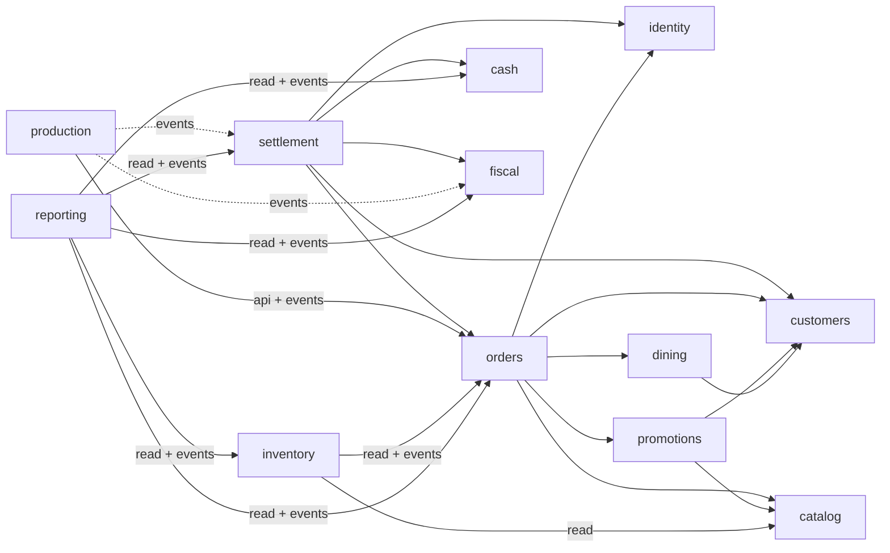

# restaurantPRO backend — R4 decisions for approval (spec Stage 4)

Status: **APPROVED** 2026-11-06 by Xavier Francisco ("aprovado": every recommendation, P40–P51; P31 credit notes stay with the market run; R4 includes the isolation drill and the load smoke). This document continues [backend-decisions.md](backend-decisions.md) (D1–D33, P1–P6, B1–B3), [r2-decisions.md](r2-decisions.md) (D34–D63, P7–P21, B4–B5) and [r3-decisions.md](r3-decisions.md) (D64–D98, P22–P39). Those decisions stay in force, and the ids here continue from **D99 and P40** (no new blocker id is needed). Answer by id, for example "P41: refuse negative stock" or "D105: no line split". Once approved, the decisions marked ★ become ADRs `docs/adr/0028…` in the integration slice.

Source of truth: [product_description.md](../product_description.md), cited as §n. The slices, contracts and graph are in [PRD R4](../prd/r4-stage4.md). The glossary is in [CONTEXT.md](../../CONTEXT.md), and the coding rules are in [backend-conventions.md](../architecture/backend-conventions.md). The R3 code is the baseline: branch `feat/backend-stage3`, 1760 tests green.

---

## 0. Blockers and questions that need you

**Blockers to *building* R4: none.** The launch conditions B4 (a certified fiscal adapter for the chosen market, P7) and B5 (tests with the real printers) still stand. R4 adds market-dependent points to B4, all behind the fiscal adapter: the fiscal treatment of discounts, offers and loyalty rewards (D107), of menus with mixed tax rates (D108) and of the delivery fee (D128). None of them changes the R4 data model.

**No spec change is proposed.** Where the spec is silent, the simplest consistent rule is chosen and marked as an assumption in the decision that needs it.

**Questions only you can answer.** Each has my recommendation. I build R4 with it unless you override it.

| id | question | recommendation (default) | what changes if you choose otherwise |
|---|---|---|---|
| P40 | Costing method for stock. | **Weighted moving average per warehouse and stock item** (§5 "custo médio", §8.6 "margem/custo médio"). Each outgoing movement is valued at the average at posting (D113). | **FIFO:** cost layers per receipt, consumption allocated to layers; one more table and a layer lock, and margins move with receipt order. |
| P41 | Is negative stock allowed? | **Sales always post, even below zero** (§5 "não bloquear a venda"). Manual outgoing movements (waste, transfers, adjustments) are refused below zero only in a warehouse set to `REFUSE_MANUAL`; the default is `ALLOW`. "Strict availability" before a sale is the operational **sold-out flag** in catalog (D118), set by hand in R4. | **Automatic sold-out from stock:** inventory would set the flag when a balance hits zero (one more edge, inventory → catalog write, and a lag of seconds). |
| P42 | When is consumption recognized? | **At round confirmation, for every tracked family** (D116). There is no kitchen display, so the confirmed round is the production fact (§4 "Confirmar 'Pedir' grava a operação e os trabalhos de produção"). A void then reverses it, or reclassifies it as waste when `wasted = true` (D117). | **At document issue for items without preparation:** a second trigger path keyed by document lines, and voided bottles never touch stock. |
| P43 | Promotion stacking and types. | **No stacking of automatic promotions:** the best one per line wins, by priority, then the lowest resulting price, then code. A manual discount may follow, within the manual limit measured against the list price. **Types in R4:** line-level only (percent off, amount off per unit, fixed unit price), with time windows (happy hour), validity dates, scope (items, variants, families), order modes and "loyalty members only". **No multi-item promotions** (2-for-1, mix-and-match); menus cover combos. | **Combinable promotions:** a `combinable` flag, applied in priority order. **Multi-item promotions:** a rule over the whole order, which can reprice confirmed lines of earlier rounds (forbidden by §8.4) or must wait for the bill. |
| P44 | Manual discount limits. | Holders of `ORDER_DISCOUNT` give up to **10 %** alone. Up to the store's maximum (default **50 %**) they need an approver holding `ORDER_DISCOUNT_APPROVE`. An **offer** (price 0) always needs that approver. Both limits are data in the store's promotion release (D106). | Other defaults, or approver for every discount (slower at the table). |
| P45 | Loyalty earning, credit sales and expiry. | **One program for the company** (customers are company-wide, P38). Points = ⌊eligible gross ÷ spend unit⌋ × points per unit, per order, **earned when the order closes**. Eligible gross is after discounts, and excludes offered and rewarded lines. **Credit sales earn** (an order is SETTLED with authorized credit, §8.3). **No expiry by default**; redemptions consume earnings first-in-first-out, so an expiry period can be switched on later without migrating data. | **Earn only on money received:** credit sales earn when the debt is paid, which needs customers → promotions events. **Expiry of N months:** a nightly job posts EXPIRY entries. |
| P46 | What a loyalty redemption is. | **A reward that lowers the price of one unit** (free unit or an amount off one unit), recorded as a discount of origin LOYALTY (D112). It reduces the taxable base like any discount. | **A payment method "points":** tax stays on the full price, but every payment creates a cash movement (D52), and points are not money (§7.7). |
| P47 | Reservation no-shows. | A BOOKED reservation becomes **NO_SHOW automatically 30 min after its start** (store setting), by a job acting as SYSTEM. Staff may mark it earlier, once the start has passed. **No deposits or fees.** The map shows the "reserved" indicator from 120 min before the start (store setting). | Manual only: the calendar fills with stale BOOKED rows. Deposits: a payment target for reservations (settlement work, not in Stage 4). |
| P48 | Delivery fee, tax and payment. | **The fee is a catalog item of kind FEE per delivery zone**, added as an automatic line when the delivery order opens. It carries its own tax category and its published price, so the frozen-snapshot rule and D59 apply unchanged. It can be removed only by a discount or offer. **Payment:** at the store, or **cash on delivery recorded by the cashier when the courier returns**. The courier carries a **non-fiscal delivery slip**. The document is issued at close, as for every order. | **Fee as an amount on the zone:** a line with no catalog snapshot, which D58 forbids. **Document at dispatch:** a returned delivery would then need a corrective document (P31). |
| P49 | Waiter floats ("bolsas"), envelopes and `CashShift` (P34). | **Not in R4. A run R5 "completion"** takes them, together with the other Stage 2 leftovers: pub/cards, "takeaway seguro" and own consumption (P15). Courier cash in R4 goes through the cashier (P48). | **In R4:** a second cash responsibility model, about one more cash slice and one settlement slice; delivery couriers would then hold their own float. |
| P50 | Menus (P35). | **In R4. A menu is one billed line at the menu price, with the menu item's tax category.** The chosen components are child records with no amount, used by production and stock (D108). | **Price allocated across components**, each with its own tax rate: correct where a regime taxes a bundle per component, but it adds a menu-group concept to partitions and voids. The market run decides if it is needed. |
| P51 | Supplier invoices. | **No separate supplier-invoice entity.** A goods receipt records the supplier's document reference and the invoiced costs. A price difference found later is a **cost correction** fact (D125). No accounts payable (§5 "não inclui contabilidade geral"). | **Supplier invoice with three-way matching:** a new aggregate, its own states and a variance account, which the spec does not ask for. |

**Confirmations (no choice expected):**
- **P31 (credit notes and corrective documents) stays with the market run, not R4.** The market (P7) is still unknown, and §5 forbids guessing its documents. R4 keeps refusing corrections of invoiced quantities with `CORRECTION_REQUIRES_FISCAL_ADAPTER`, for discounts as for voids.
- **R4 closes the two R3 release gaps** as slices of their own: the §14 #1 two-installation isolation drill and a 10-terminal load smoke (D136).

---

## 1. Scope (§13 Stage 4: "Compras, receitas, inventários, promoções, fidelização, reservas e delivery")

| area | IN R4 | deferred (where) |
|---|---|---|
| Purchasing (§5 "Fornecedores, encomendas, receções parciais, devoluções") | `Supplier`, supplier items with last cost, `PurchaseOrder`, partial `GoodsReceipt`, `SupplierReturn`, cost corrections | Supplier invoices and payables (P51); EDI with suppliers |
| Recipes (§5 "receitas… fichas técnicas… rendimento, ingredientes, embalagem e versão") | `Recipe` + immutable `RecipeVersion` per item/variant, and preparation recipes for prepared stock items; units and conversions | Nutrition and allergens (not in the spec) |
| Inventory (§5 "armazéns, transferências, inventários, ajustes, stock mínimo, custo médio") | Warehouses, stock items, ledger, balance projection with moving average, consumption from rounds, waste, adjustments, counts with cut-off, transfers (same store and between stores), preparation runs, minimums, stock reports | Automatic sold-out (P41); FIFO (P40); lot and expiry-date tracking |
| Promotions (§5 "Promoções, happy hour… regras de acumulação, ofertas e limites de desconto") | The `promotions` module: per-store promotion releases, line-level promotions with windows, discount limits, manual discounts and offers on confirmed lines | Multi-item promotions (P43); coupons |
| Loyalty (§5 "Fidelização usa movimentos rastreáveis, incluindo reversões", §8.4) | Company-wide program versions, member accounts, `LoyaltyPointLedger` (earn, redeem, reversals, adjustments), rewards | Expiry on by default (P45); tiers |
| Menus and catalog extensions (P35; §4, §8.6) | Menus, quick pages, daily dishes, macros, automatic items, fee items, sold-out flag | Menu supplements (spec silent) |
| Reservations (§4, §8.3) | `Reservation` BOOKED → SEATED / CANCELLED / NO_SHOW, tables, calendar, map indicator, seating through the table open | Capacity and overlap prevention (§4: "evolução explícita"); deposits |
| Delivery (§4 "delivery por telefone… cliente, morada, zona/taxa, estado de entrega e histórico") | `OrderMode.DELIVERY`, `Delivery` lifecycle and history, zones with fee item, courier, delivery slip | Marketplace and GPS fleet (§4: excluded); courier floats (P49) |
| Reports (§5, §8.6 "margem/custo médio… rotação, mínimos, quebras e divergências") | Reporting: cost of goods, margins, discounts and offers. Inventory: valuation, rotation, below minimum, waste, count divergences, purchases | — |
| R3 deferrals | §14 #1 isolation drill; 10-terminal load smoke | P34 bolsas → R5 (P49); P31 → market run |

**Module placement (part of D99).** R4 creates two modules, `promotions` and `inventory` (D1: a module is created when its stage starts). Purchasing, recipes and stock live in `inventory`, and loyalty in `promotions`, as §6 and §8.1 place them (`LoyaltyPointLedger` belongs to promotions, not customers; `StockItem` and recipes to inventory). Reservations live in `dining` (§6 "Áreas, mesas e reservas"). Delivery is an attribute of the order and lives in `orders` (§8.1 "modo de pedido é atributo próprio"). No new "purchasing", "loyalty" or "delivery" module is created: they are subpackages.

---

## 2. Modules and dependencies

**D99 ★ — Allowed dependencies for R4.** This is D65 with these amendments (⊕ added). Every D35 and D65 forbidden edge stays, and the reporting read-only rule (D84) stays.

```
promotions → shared, audit, access, organization(+dto), catalog(root,+dto), customers(root,+dto)        NEW
inventory  → shared, audit, access, organization(+dto), catalog(root,+dto,+event), orders(root,+event)  NEW (reads only)
orders     → … D35 …, promotions(root,+dto) ⊕, customers(root,+dto) ⊕                                     NOT settlement, production, inventory
dining     → … R1 …, customers(root) ⊕                                                                   (reservation contact, read only)
reporting  → … D65 …, inventory(root,+event) ⊕                                                           (reads only)
production → unchanged (orders root and orders::event already cover the new events)
settlement → unchanged (it calls the new OrdersApi methods only)
```

| rule | why | rejected alternative |
|---|---|---|
| `orders → promotions` (planned in D13) | Prices are fixed at confirmation (§8.4), so orders asks promotions for the effective price inside the confirming transaction. Loyalty writes (redeem, reverse, earn) are synchronous calls from orders, in the same transaction as the fact that causes them. | promotions listening to orders events: earning would need promotions → orders, a cycle with orders → promotions. |
| `promotions ↛ orders, settlement, fiscal, cash, production, inventory, dining, reporting` | Promotions owns rules and the points ledger. Its callers pass the facts it needs (lines, amounts, customer). | Promotions pulling orders: the cycle above. |
| `inventory` calls only read-only facade methods, and only `reporting` depends on it | Stock consumes facts through persisted mechanisms (§6). It never writes to orders or catalog. | Orders calling inventory at confirmation: stock processing would then block a sale (§5). |
| `orders ↛ inventory`, `settlement ↛ inventory` | A financial reversal never restores stock (§8.4). Only order facts (rounds, voids) reach inventory, and only through events. | Settlement events into inventory: a refund could then be read as a stock return. |
| `orders → customers`, `dining → customers` (root, read) | Delivery and loyalty need a customer on the order; a reservation may name one. Integrity through the owner's API (D6). Customers depends on no business module, so no cycle. | Free-text customer data on the order: delivery history per customer (§4) would be lost. |
| `inventory → catalog` (read) | Recipes name catalog items and variants; families come from the release a line was priced from. | — |

Enforcement: each new `package-info.java` declares these lists, and `ModularityTests.modulesRespectTheirDeclaredBoundaries` checks them. `ArchitectureTests.forbiddenModuleDependenciesAreAbsent` gains `promotions ↛ {orders, settlement, fiscal, cash, production, inventory, dining, reporting}`, `inventory ↛ {settlement, fiscal, cash, customers, promotions, dining, production}`, and `nothing → inventory except reporting`. The new rule `inventoryCallsOnlyReadOnlyFacadeMethods` mirrors `reportingCallsOnlyReadOnlyFacadeMethods`. Each rule gets an `ArchitectureRulesFireTest` fixture in `com.xavier.archfixture.*`; rules for packages that do not exist yet use `allowEmptyShould(true)`.



**D100 — New public facades** (root packages, D36; reads `readOnly`, writes `MANDATORY` and never authorizing). Signatures are in the PRD.
- `promotions.PromotionsApi` (readOnly, for orders): `price(PricingRequest)`, `currentVersion(storeId)`, `discountLimits(storeId)`. `promotions.PromotionEngine` is the pure evaluator behind it.
- `promotions.LoyaltyApi` (for orders): `redeem` and `reverseRedemption` and `earnForOrder` (`MANDATORY`), `balance` and `isMember` (readOnly).
- `inventory.InventoryFacts` (readOnly, for reporting): movement sets by source, paged source ids.
- `orders.OrdersApi` additions: `batchFacts(batchId)` and `discountFacts(sourceType, sourceId)` (readOnly), `adjustLinePrice(SettledAdjustmentCommand, approver)` (`MANDATORY`, for settlement, D105), and `VoidFacts.consumedLineId`. `OrderBillingView` gains `customerId` and `delivery`; `BillingLine` gains `listUnitPrice` and `discountLabel`. Both records keep a constructor with the old components.
- `orders.OrdersProductionApi.deliverySlip(orderId)` (readOnly, D129).
- `catalog.CatalogApi` additions: `items(ids)` (working copy, for recipes), `soldOut(storeId)` and `dailyDishes(storeId, date)` (operational, D109).
- `customers.CustomersApi.address(customerId, addressId)` (readOnly).
- `dining.DiningApi.openOccupation(…, reservationId)` overload (D126).

---

## 3. Aggregates and state machines (§8.3)

As before, every transition is a method on the aggregate, and an illegal transition is a `ConflictException` subclass (409). Each machine has a plain unit test over all states and commands. Facts are append-only, protected by a DB trigger.

| aggregate (module) | states / transitions | invariants (how enforced) |
|---|---|---|
| `PromotionRelease` (promotions) | `DRAFT → VALIDATED → PUBLISHED → RETIRED`, as `ConfigurationRelease` (§5 "Publicação versionada"). Publishing retires the previous PUBLISHED release of the store. | One PUBLISHED per store (partial unique). The frozen `jsonb` snapshot is immutable (trigger). `version` increases per store. |
| `Promotion` (promotions, working copy) | `active` flag, `@Version`. Never read by orders; only releases are. | Validity `from < to`; percent in (0, 100]; scope not empty. |
| `LoyaltyProgramVersion` (promotions) | `DRAFT → PUBLISHED → RETIRED`; publishing retires the previous one. Company-wide. | One PUBLISHED (partial unique). Immutable once published. |
| `LoyaltyAccount` (promotions) | `ACTIVE ↔ SUSPENDED` (flag, with reason), `@Version`. One per customer. | **No balance column.** Balance = Σ ledger (D110). The row is the lock for redemptions. |
| `LoyaltyPointLedger` entry (promotions) | A fact: `EARN`, `REDEEM`, `EARN_REVERSAL`, `REDEEM_REVERSAL`, `ADJUSTMENT`, `EXPIRY`. | `points ≠ 0` with the sign fixed by kind (CHECK). `UNIQUE(source_type, source_id, kind)`. `ADJUSTMENT` ⇒ reason. Immutable. |
| `LoyaltyAllocation` (promotions) | A fact: which earning a debit (redeem, expiry, negative adjustment) consumes. | Σ per earning ≤ its points; Σ per debit = its points (deferred triggers, as `CreditSettlement`). |
| `OrderLine` (orders, amended) | Unchanged machine. Gains `kind` (`STANDARD`, `MENU`, `FEE`), `list_unit_price`, the promotion snapshot and `automatic`. | CHECK `unit_price ≤ list_unit_price`. A MENU line has components. R3 rows keep `list_unit_price NULL` (= `unit_price`); added by `ALTER … ADD COLUMN`, so no confirmed row is updated. |
| `OrderLineComponent` (orders) | A fact, frozen at confirmation. | `quantity > 0`, no amount. Immutable once its line is CONFIRMED. |
| `OrderLinePriceAdjustment` (orders) | A fact: `DISCOUNT`, `OFFER`, `REWARD`, `REVERSAL`. | `UNIQUE(line_id, seq)`. `0 ≤ unit_price`; DISCOUNT, OFFER and REWARD lower the price, REVERSAL raises it back up to at most the list price. Reason, operator and (where D106 needs one) approver. Immutable. |
| `OrderLineSplit` (orders) | A fact: q units of a confirmed line moved to a new CONFIRMED line of the same order. | The new line has `origin_split_id` and no batch, so production and stock never see it twice (like a transfer, §8.2). Net quantity = confirmed − voids − transfers out − splits out. |
| `Delivery` (orders) | `PENDING → OUT_FOR_DELIVERY → DELIVERED`; `OUT_FOR_DELIVERY → RETURNED → OUT_FOR_DELIVERY` (retry); `PENDING` or `RETURNED → CANCELLED` (with the order). Independent of `Order.lifecycle`, the financial state and the fiscal state (§8.3). | One per DELIVERY order (PK `order_id`). The address is a snapshot, frozen at dispatch. Every transition writes a `DeliveryEvent` (the history, §4). |
| `Reservation` (dining) | `BOOKED → SEATED`, `CANCELLED` or `NO_SHOW` (§8.3). | SEATED ⇒ `occupation_id` NOT NULL. Informative: it never blocks an occupation or a sale (§8.3). `@Version` while BOOKED. |
| `StockMovement` (inventory) | A fact. | `UNIQUE(source_type, source_id, stock_item_id, type, warehouse_id)` (§8.2). Signed quantity and value, unit cost at posting. Immutable. |
| `StockBalance` (inventory) | A projection, not a fact. | Updated in the posting transaction under `FOR UPDATE`. Σ movements = balance (reconciliation job, D113). |
| `RecipeVersion` (inventory) | `DRAFT → ACTIVE → SUPERSEDED`. Activating one supersedes the previous ACTIVE version at its `effective_from`. | One ACTIVE per recipe (partial unique). Ingredients immutable once ACTIVE (trigger). Effective periods do not overlap. |
| `StockCount` (inventory) | `DRAFT → IN_PROGRESS → SUBMITTED → APPROVED` or `REJECTED`; `DRAFT` or `IN_PROGRESS → CANCELLED`. A rejected count is kept; a recount is a new count. | Lines editable until SUBMITTED. APPROVED posts COUNT_ADJUSTMENT movements once (source = count line). |
| `StockTransfer` (inventory) | `DRAFT → SHIPPED → RECEIVED`; `DRAFT → CANCELLED`. Within one store, ship and receive happen in one command. | Different warehouses. Received ≤ shipped per line. |
| `Preparation` (inventory) | `DRAFT → CONFIRMED`; `DRAFT → CANCELLED`. | Confirmation posts the ingredient OUTs and the output IN in one transaction. |
| `PurchaseOrder` (inventory) | `DRAFT → SUBMITTED → CLOSED`; `DRAFT` or `SUBMITTED → CANCELLED`. Receipt progress (`NONE`, `PARTIAL`, `FULL`) is derived from receipts, never stored. | A SUBMITTED order's lines are immutable. CANCELLED only with no confirmed receipt. |
| `GoodsReceipt` (inventory) | `DRAFT → CONFIRMED`; `DRAFT → CANCELLED`. Only CONFIRMED changes stock (§8.4). | Confirm is a CAS. Lines immutable once CONFIRMED. |
| `SupplierReturn` (inventory) | `DRAFT → CONFIRMED`; `DRAFT → CANCELLED`. | Returned ≤ received for a linked receipt line. |
| `ReceiptCostCorrection` (inventory) | A fact. | References one CONFIRMED receipt line; posts one REVALUATION (D125). |

---

## 4. Prices, promotions and discounts

| id | decision | alternatives rejected / why |
|---|---|---|
| **D101 ★ — Every discount is an effective unit price** | A promotion, a manual discount, an offer and a loyalty reward all produce one thing: the line's **effective unit price**, in the currency's minor units (D15), with `0 ≤ effective ≤ list`. `LineAmounts.of(effective, netQty, rate)` (D59) stays the only amount rule, so partitions (D68), the tax cent rule (D96), fiscal's line check and the documents are unchanged. Percent off is `round_HALF_UP(price × (1 − p/100))` **per unit**, so 10 % off 1.25 is 1.13 (a 0.12 discount). An offer is effective 0.00. A bill-wide percent is the same percent applied to each chosen line. The discount amount is `LineAmounts.of(list, q, rate).gross − LineAmounts.of(effective, q, rate).gross`, never stored as a separate money column. Its origin is stored (promotion, manual, loyalty, §8.4 "guardar origem"). | (a) A discount amount on the line, subtracted from the gross: it has to shrink with voids and be split by D68, which would need cross-line terms and a new fiscal bound. (b) Negative discount lines: §8.4 forbids negative totals and fiscal lines have `quantity > 0` and non-negative amounts; their treatment is regime-dependent. (c) Bill-level discounts allocated across lines: allocated cents do not divide by quantity, so the unit price would not be exact. |
| **D102 — Promotion releases per store, frozen like the catalog** | Admins edit promotions, the store's discount limits and its time windows in working-copy tables. A **`PromotionRelease`** per store freezes them as a `jsonb` snapshot (`PromotionSnapshot`, schema version 1) with the D31 states. Orders reads only the current published release, through `PromotionsApi`. A line confirmed under release R records `promotion_release_id` and the applied promotion's id, code and name, so republishing never changes it (§5 "Publicar nova configuração não recalcula consumos antigos", §14 #7). | (a) Promotions inside the catalog release: catalog would own campaign rules, which §6 gives to promotions. (b) Reading live promotion rows at confirmation: an edit would change prices mid-service with no published control point. |
| **D103 — The engine, its instant and stacking (P43)** | `PromotionEngine.evaluate(snapshot, request)` is a pure function. Inputs per line: item, variant, family (from the line's catalog release), list unit price and quantity; context: the confirmation instant, the store zone, the order mode and whether the customer is a loyalty member. Windows (days of week, local start and end times, which may cross midnight) are read in the **store's zone at the confirmation instant**, as tax is (D58). Per line, the eligible promotions are filtered by validity, window, mode, scope and membership, and **one** is applied: highest `priority`, then lowest resulting price, then `code`. The result never exceeds the list price (an "offer" price above list is ignored). Drafts show the same evaluation as a preview. | Evaluating at draft creation: the price would depend on when the waiter typed the line, not on the confirmation that fixes it (§8.4). |
| **D104 — Visible recalculation at confirmation** | `POST /orders/{id}/batches` gains `promotionVersion` (null when none is published) and `expectedGross` (Σ preview gross that the POS showed). A different published promotion release → 409 `PROMOTIONS_CHANGED`, as `CATALOG_CHANGED`. A recomputed Σ gross ≠ `expectedGross` (a window boundary passed) → 409 `PRICES_CHANGED` with the new preview. The POS re-reads and shows the new prices (§8.4 "exigem recálculo visível"). `expectedGross` is optional so the R2/R3 clients and tests keep working; the POS contract requires it. | Checking versions only: a happy hour that ends between the preview and the tap would change the price silently. |
| **D105 — Discounts after confirmation are facts, with a split for part of a line** | `POST /pos/orders/{id}/discounts {orderVersion, lines[{lineId, quantity?}], kind DISCOUNT\|OFFER\|REWARD\|REVERSAL, percent?\|unitPrice?\|rewardCode?, reason}` writes one `OrderLinePriceAdjustment` per line (§9 "/discounts", §8.4 "operação explícita e auditada"). The effective price is the latest adjustment's, else the line's snapshot. A `quantity` below the net quantity first **splits** the line: an `OrderLineSplit` fact and a new CONFIRMED line of that quantity with the same snapshot, no batch and `origin_split_id`; the adjustment applies to the new line. **Bill-reducing**, so it follows D49/D71: the orders route works only with billing lock NONE (422 `ORDER_IN_SETTLEMENT`); under the PAYMENT lock the POS uses `POST /pos/orders/{id}/settlement/discounts` (settlement, D71 pattern): `order_settlement FOR UPDATE` → no quantity of the line in a LIVE partition (422 `QUANTITY_PARTITIONED`) and none covered by a document (422 `CORRECTION_REQUIRES_FISCAL_ADAPTER`) → the ORDER residual after the discount ≥ what the ORDER target has paid, on account or in flight (422 `DISCOUNT_EXCEEDS_UNPAID`) → `OrdersApi.adjustLinePrice` (`MANDATORY`). `REVERSAL` raises the bill and is allowed only with lock NONE. Publishes `LineDiscountsRecorded`. | (a) Void and re-add at the lower price: the kitchen would get a void ticket and a new ticket for food that was never cancelled, and stock would be reversed and consumed again. (b) Discounts only on drafts: a manager could never offer a dessert already sent (§4 "ofertas"). (c) No split, so a discount covers the whole line: offering 1 of 3 coffees would be impossible. |
| **D106 — Discount limits (P44)** | The store's promotion release carries `DiscountLimits(freeLimitPercent, maxPercent)`. The discount percent is measured cumulatively against the **list** price: `1 − effective/list`. ≤ free limit: `ORDER_DISCOUNT` alone. ≤ max: plus an approver with `ORDER_DISCOUNT_APPROVE` (D40 headers; missing or wrong → 403, as voids). > max: 422 `DISCOUNT_LIMIT_EXCEEDED`. `OFFER` needs `ORDER_OFFER` and always the approver. `REWARD` needs `LOYALTY_REDEEM` and no approver (the points pay for it). The approver must not be the operator (422 `SELF_APPROVAL`). Automatic promotions are not limited: they are published configuration. With no promotion release published, the limits are 0 % free and 100 % max. | Limits per role: they would duplicate RBAC data in promotions. |
| **D107 — Tax effect** | Prices are gross (P9). A discounted line's tax is the line rate applied to the discounted gross, by D59; an offered line has gross, net and tax 0.00. The document line carries `listUnitPrice` and a `discountLabel` for printing, and its amounts are the effective ones. **Assumption (B4):** that discounts, offers and rewards reduce the taxable base. A regime that taxes offers at full value, or wants discounts as separate document lines, is handled by its market adapter from `listUnitPrice` and the label, with no change to orders. | Taxing offers at full value now: a guess about the regime (§5). |

---

## 5. Menus and operational catalog (P35, P50)

| id | decision | alternatives rejected / why |
|---|---|---|
| **D108 — Menus** | A catalog item of kind `MENU` has **component groups** (`code`, `name`, `minChoices`, `maxChoices`, options of item/variant/quantity). The release snapshot (schema version 2) carries them. A MENU draft carries its choices; confirmation validates them against the snapshot (422 `MENU_SELECTION_INVALID`) and freezes them as `OrderLineComponent` rows (item, variant, code, description, quantity, destination). **Only the menu line is billed**, at the menu price with the menu item's tax category (P50). Components have no amount: production prints each on its own destination (a menu's starter to the kitchen, its drink to the bar), and inventory consumes each component's recipe. A void or a discount acts on the menu line, and its components follow pro rata. | (a) Menu price allocated across components: see P50. (b) Components as zero-price billing lines: documents would list them, partitions could take them, and voids would have to keep the group consistent. |
| **D109 — Quick pages, macros, automatic items, daily dishes, sold-out** | **In the release** (configuration that prices or composes lines): quick pages (ordered entries of items, variants or macros), **macros** (a named list of item/variant/quantity added as drafts by `POST /pos/orders/{id}/lines/macro`), and **automatic items** (`TABLE_OPEN_PER_GUEST` adds quantity × guests as drafts when a table opens, for example a cover charge; `ORDER_OPEN` per mode). Automatic drafts are flagged `automatic` and behave as normal drafts. **Operational, outside the release** (availability changes during service and changes no price, §5 "disponibilidade"): the **sold-out flag** per store × item or variant (`catalog.item_availability`, `CATALOG_AVAILABILITY`), and **daily dishes** per store × business date (`catalog.daily_dish`, items that must be in the published release). A sold-out item at confirmation → 422 `ITEM_SOLD_OUT`. Old v1 snapshots parse with empty lists. | Sold-out and daily dishes in the release: a republish per change during service, and every republish retires the release the drafts priced from (409 `CATALOG_CHANGED` for every open table). |

---

## 6. Loyalty (§5, §8.4)

| id | decision | alternatives rejected / why |
|---|---|---|
| **D110 ★ — A points ledger, never a stored balance** | `LoyaltyAccount` (one per customer, company-wide, P38/P45) and `LoyaltyPointLedger` entries in `promotions` (§8.1). Points are whole numbers. **Balance = Σ entries**, never stored. Debits (REDEEM, EXPIRY, negative ADJUSTMENT) are allocated to earnings FIFO by `occurred_at` through `LoyaltyAllocation`, so an expiry rule needs only the remaining points per earning. Every reversal is a new entry referencing the original (§5 "incluindo reversões"); manual adjustments need `LOYALTY_ADJUST` and a reason (§8.4). Enrollment is explicit (`POST /customers/{id}/loyalty`), never implied by a sale. | (a) A `points` column on the account: a second source of truth (same reasoning as D73). (b) Loyalty in customers: §8.1 puts the ledger in promotions. |
| **D111 — Program versions and earning (P45)** | A company-wide `LoyaltyProgramVersion` (`DRAFT → PUBLISHED → RETIRED`) holds `spendUnit` (money), `pointsPerUnit`, eligible families or items (empty = all) and the rewards. **Earning** happens in `OrdersApi.close`, which settlement calls in tx-C (D55, D70): when the order has a customer with an ACTIVE account, orders calls `LoyaltyApi.earnForOrder` with each billing line's item, family (from the line's release), effective gross and whether it was rewarded. Eligible gross excludes rewarded lines and is after every discount; points = ⌊Σ eligible ÷ spendUnit⌋ × pointsPerUnit, under the program version PUBLISHED at the close instant (recorded on the entry). `UNIQUE(source ORDER, order_id, EARN)`, so a resumed close (D63) earns once. A reprint or a refund of an overpayment changes nothing (§8.4). | Earning from a settlement or fiscal event: asynchronous, and promotions would need an edge back into orders (D99). |
| **D112 — Redemption is a reward on one unit (P46)** | A reward (`code`, `pointsCost`, effect `FREE_UNIT` or `AMOUNT_OFF_UNIT`, scope) is redeemed by `POST /discounts {kind: REWARD, rewardCode, lines[{lineId, quantity: 1}]}` on a confirmed line of an order that has a member customer (422 `LOYALTY_CUSTOMER_REQUIRED`). Orders splits one unit off when needed (D105) and calls `LoyaltyApi.redeem` (`MANDATORY`) in its transaction: `loyalty_account FOR UPDATE` → ACTIVE (422 `LOYALTY_ACCOUNT_SUSPENDED`) → balance ≥ cost (422 `LOYALTY_INSUFFICIENT_POINTS`) → REDEEM entry and its allocations, `UNIQUE(source ORDER_LINE, line_id, REDEEM)` → the new unit price. **The race prevented:** two terminals redeeming the customer's last points at once. Voiding a rewarded line calls `LoyaltyApi.reverseRedemption` in the void transaction (REDEEM_REVERSAL, also on the settled-void path). Changing the order's customer after a redemption → 422 `LOYALTY_REDEEMED`. | Redeeming at draft time: points would be held for drafts that may be deleted. A payment method "points": P46. |
| **D112a — A rewarded line moves with transfers and merges (amends D112, S46 review)** | A line that carries a reward is transferred like any line (spec §5: total and partial transfer, merge): the copy keeps its effective price. Voiding it, or any line descended from it, reverses the redemption: orders walks back from the voided line through the transfer and split facts to the line that holds the REWARD (the nearest ancestor whose REWARD precedes the fact that moved the quantity away, as `VoidFacts.consumedLineId` walks for inventory) and calls `LoyaltyApi.reverseRedemption` with that line. **The redemption is reversed exactly once, by the void that leaves the reward's lineage (the reward-holding line plus its transferred and split copies made at or after the reward) with net quantity 0.** Earlier partial voids return no points; the reward stays, because units still carry it. So a 0.5 + 0.5 void, a unit transferred in parts, or a unit split by a later discount gives the points back on the last void, and never meets `LOYALTY_SOURCE_MISMATCH`. **Concurrency (D133):** before reading the lineage's net, the void locks the reward-holding line's row (`orders.order_line FOR NO KEY UPDATE`, right after its own order's version claim), so voids of copies in two orders queue and the second reads, in a new statement, the net the first committed. A line that already carries a reward, its own or an inherited one, refuses another (422 `REWARD_ALREADY_REDEEMED`) and a REVERSAL; its bill label is the reward's. The points go back to the customer recorded on the REDEEM entry, whatever the customer of the order the copy now sits on. Earning (D111) treats a copy of a rewarded line as rewarded. | Refusing to transfer a rewarded line: it blocks merging any table with a redeemed reward, which §5 requires. |

---

## 7. Stock accounting (§5 "Stock, receitas e compras", §8.2, §8.4)

| id | decision | alternatives rejected / why |
|---|---|---|
| **D113 ★ — Ledger, balance projection, weighted moving average (P40)** | `StockMovement` is the record of reference (§5 "Movimentos são o registo de referência"). Each one stores a signed `quantity` (base unit, `NUMERIC(19,6)`), `unit_cost` (`NUMERIC(19,6)`), signed `value` (`NUMERIC(19,4)`), the currency, its source, recipe version, `business_date`, `occurred_at` (the economic instant: the line's confirmation, a receipt's confirmation, a count line's `counted_at`) and `posted_at` with a `posting_seq`. **`StockBalance(warehouse, stock item)`** holds quantity, value and average cost, and is updated **in the posting transaction under `FOR UPDATE`**, in ascending `(warehouse_id, stock_item_id)` order across items, so posting is serialized per item and deadlock-free. IN movements carry their own cost; OUT movements are valued at the current average: `value = −round(q × avg, 4)`. When an IN brings a negative quantity back above zero, a `REVALUATION` (quantity 0) moves the value so that `value = quantity × new cost`. Valuation rounding is HALF_UP at scale 6 for unit costs and 4 for values; reports round to minor units only when they display money. **The balance is a reconcilable projection** (§5): Σ movements = balance in quantity and value, checked by a nightly job (alert `inventory_balance_drift`), and `POST /backoffice/inventory/balances/rebuild` replays it in `posting_seq` order. | (a) No balance row, average computed on read: the moving average depends on posting order, so every read would replay the item's history. (b) A periodic (monthly) average: margins would be unknown until period end, and §8.6 asks for "custo médio". (c) FIFO: P40. |
| **D114 — Stock items, units, warehouses, routes** | `StockItem` (company-wide code, name, base unit, kind `PURCHASED` or `PREPARED`). Units: a seeded, code-defined set of `StockUnit` per dimension (MASS g/kg, VOLUME ml/l, COUNT un) with factors to the base unit; converting across dimensions → 422 `UNIT_DIMENSION_MISMATCH`. Packs per stock item (`StockItemPack`: "caixa 12 un", "saco 25 kg") convert purchase quantities. Catalog's `Unit` remains the sale unit and is not duplicated: it has no conversion semantics. `Warehouse` belongs to one store (§8.1 "Armazém… inventory") with `negative_policy` (D118). `ConsumptionRoute(store, production destination or default → warehouse)` decides where a line consumes, so the bar consumes from the bar store-room. `StockLevel(warehouse, item).min_quantity` is the minimum (§5 "stock mínimo"). | Reusing catalog units: it would need conversions added to a sale-unit table, and catalog would own stock semantics. |
| **D115 — Recipes and versions** | `Recipe` per catalog item and optional variant (the variant's recipe wins over the item's), or per PREPARED stock item (a preparation recipe). Its `RecipeVersion` has `yield_quantity` and unit (§5 "rendimento"), ingredient lines (stock item, quantity, unit, kind `INGREDIENT` or `PACKAGING`; packaging may be limited to modes, for example a box only for TAKEAWAY and DELIVERY) and `effective_from`/`effective_to`. Per sold unit, an ingredient consumes `quantity ÷ yield` in its base unit. ACTIVE versions are immutable; a change is a new version. Consumption uses **the version effective at the line's confirmation instant**, so a late-processed round and a recipe change never interact (§8 "snapshots de… receita"). A preparation recipe that reaches itself → 422 `RECIPE_CYCLE`. | Recipe snapshot in the catalog release: §8.1 gives recipes to inventory, and a recipe change would need a catalog republish. |
| **D116 ★ — Consumption: an event-triggered, idempotent pull from the confirmed round (P42)** | Inventory listens to `OrderBatchConfirmed` (it exists, and its publication is persisted, D19) and **pulls** `OrdersApi.batchFacts(batchId)` (readOnly: mode, business day, confirmation instant, and per line item, variant, release, quantity, destination and menu components), the D84 pattern. In one transaction it resolves, per line or component, the consumption rule of its family (`ConsumptionPolicyVersion`, versioned, effective at confirmation: `tracked` true or false; trigger `ROUND_CONFIRMED`, the only value in R4), the recipe version, and the warehouse from the route, then posts `SALE_CONSUMPTION` movements with source `ORDER_LINE` (or `ORDER_LINE_COMPONENT`) and `INSERT … ON CONFLICT DO NOTHING` on the D113 unique key. A redelivered event posts nothing new. **A delay never blocks a sale:** the order transaction never touches inventory; the backlog is visible as `pendingFacts` (D86's `EventPublicationStats`) on `GET /backoffice/inventory/status`. Transferred and split lines have no batch, so they are never consumed twice (§8.2). Lines with no recipe, no route or an inactive stock item become a `ConsumptionException` (visible, `reprocess` after the fix), never a silent skip. | (a) A batch job scanning confirmed lines: a second mechanism next to the registry, with its own cursor. (b) Consuming from settlement or fiscal events: a financial reversal would then look like a stock fact, which §8.4 forbids. (c) Consuming at batch DISPATCHED: it only means production received the work (§8.3), and it happens milliseconds later. |
| **D117 — Voids, waste, offers, transfers and refunds** | Inventory also listens to `OrderLinesVoided` and pulls `VoidFacts` (it gains `consumedLineId`, the batch line the void ultimately comes from, through transfers and splits). `wasted = false` (an error, nothing prepared) → `CONSUMPTION_REVERSAL` IN at the original movement's unit cost, quantity = consumed × void qty ÷ line qty, capped at what is still unreversed (§8.4 "reversão de erro"). `wasted = true` → that reversal **and** a `WASTE` OUT of the same quantity and value: stock does not change, and the cost moves from sale to waste (§4 "Desperdício é registado mesmo sem receita de venda"). Manual waste of stock items is its own movement (`INVENTORY_MOVE`, reason). **An offer or discount changes no stock** (§8.4 "não elimina consumo"); reports find the cost of offers by joining. **Refunds, credit notes and payment reversals never reach inventory** (§8.4). A physical return to stock of a usable item is a manual `RETURN_TO_STOCK` with a reason. | A void always restoring stock: food that was cooked and thrown away would reappear in stock. |
| **D118 — Negative stock and availability (P41)** | Consumption always posts, even below zero; a negative balance is listed as an exception and counted in the gauge `inventory_negative_balances{store}`. `Warehouse.negative_policy`: `ALLOW` (default) or `REFUSE_MANUAL`, which refuses manual OUT movements (waste, transfer ship, manual adjustment, supplier return) that would go below zero (422 `NEGATIVE_STOCK_REFUSED`). "Strict availability validated before the sale" (§5) is the catalog sold-out flag (D109), checked at confirmation. | Refusing a sale at confirmation from the stock balance: orders → inventory, and the balance lags the confirmed rounds, so the check would be wrong exactly at service peaks. |
| **D119 — Counts with a cut-off** | `StockCount` per warehouse with a scope (all items or a list). Each line records `counted_quantity` and `counted_at`. The expected quantity of a line is Σ movements of that item with `occurred_at ≤ counted_at`, so sales during the count are handled (§8.4 "instante de corte e movimentos posteriores"). **Approval refuses while any consumption publication is pending** (409 `CONSUMPTION_BACKLOG`), because a round confirmed before `counted_at` may not be posted yet. Approval posts `COUNT_ADJUSTMENT = counted − expected` per line with `occurred_at = counted_at`, valued at the current average. Approve is a separate command and permission from counting (`INVENTORY_COUNT` versus `INVENTORY_COUNT_APPROVE`), and divergences are reported (§8.5 "Confirmar entradas/ajustes, custos e divergências"). The first approved count of a warehouse after go-live is the **opening** (`OPENING` movements at the cost entered per line). | Freezing the warehouse during a count: a restaurant counts during service. |
| **D120 — Transfers between warehouses and stores** | `StockTransfer` from one warehouse to another. **Same store:** one command posts `TRANSFER_OUT` (at the source average) and `TRANSFER_IN` (same unit cost). **Between stores:** ship (`INVENTORY_TRANSFER` at the source store) posts the OUT; receive (`INVENTORY_TRANSFER` at the destination store) posts the IN for the received quantity plus a `TRANSFER_SHORTAGE` OUT of the shortfall at the same cost. In transit = SHIPPED transfers. These are stock transfers; they are unrelated to order transfers, which stay within one store (§8.2). | One-step transfers between stores: the destination's stock would rise before the goods arrive. |
| **D121 — Preparation** | A `Preparation` confirms a preparation recipe for an output quantity: ingredient OUTs at average, and one `PREPARATION_IN` of the PREPARED stock item valued at the Σ of those outs, in one transaction (§8.4 "a política distingue preparação…"). A sale recipe may then consume the prepared item. | Prepared items consumed down to raw ingredients at sale time: batch cooking (5 l of soup) would never appear in stock. |
| **D122 — Go-live and history** | `InventoryActivation(store, active_from)`: only lines confirmed at or after `active_from` are consumed, and R1–R3 history is never backfilled. The store starts with an opening count (D119). A store without activation consumes nothing and shows `INVENTORY_NOT_ACTIVE` on its status. | Backfilling past sales: there is no opening balance to consume them from. |

**D117 amendment (S47 review, 2026-11-07):** a void with waste posts no stock movement, because the ingredients really were used; its share of the sale's cost (quantity × original unit cost) is reclassified from sale to waste in an append-only `inventory.waste_record`, audited and included in the waste report. A void without waste still posts the `CONSUMPTION_REVERSAL` IN at the original cost.

**D113 amendment (S47 review, rounds 3–4, 2026-11-07; replaces the round-3 clamp):** an OUT from a balance with `Q > 0` and `V ≥ 0` that leaves the quantity at or above zero takes its proportional share of the value, `−round(V × q ÷ Q, 4)` HALF_UP; one that empties the stock (`q = Q`) takes exactly `−V`. It never exceeds `V` and has no drift bias, so the value never goes below zero while the quantity stays at or above zero. The unit cost recorded on the OUT stays the average, as reference. The negative-stock rules are unchanged (an OUT crossing or below zero takes `−round(q × avg, 4)`; the REVALUATION back from negative). A `TRANSFER_IN` carries exactly its `TRANSFER_OUT`'s posted value, so a transfer never creates or destroys value; a void's reversal or waste share is at most what is left of the sale's value and the share that settles the sale's last quantity carries exactly what is left. D122 also gains: an activation never starts in the past (422 `ACTIVATION_IN_PAST`; up to 60 s back is taken as now); rounds sold while a store was not live stay history.

---

## 8. Purchasing (§5, §8.4 "apenas a receção confirmada altera stock")

| id | decision | alternatives rejected / why |
|---|---|---|
| **D123 — Suppliers and price updates** | `Supplier` is company-wide (code, name, tax id, contacts, active). `SupplierItem(supplier, stock item, pack)` holds the supplier's code and **the last cost**, updated by each confirmed receipt (configuration, not a fact; the receipt line is the fact). Purchase order lines default to it. Purchase costs never change catalog sale prices; margins show the effect (D131). | A supplier price list with validity periods: not in the spec. |
| **D124 — Purchase orders** | `PurchaseOrder` per store and warehouse with lines (stock item, pack, quantity, unit cost). DRAFT lines are editable; SUBMITTED is immutable. Receipt progress per line and order is derived from confirmed receipts (`NONE`, `PARTIAL`, `FULL`), never stored, so the lifecycle states stay separate from the receipt state (as §8.3 separates states elsewhere). `CLOSED` short-closes an order that will not be fully delivered. A purchase order changes no stock. | Storing PARTIALLY_RECEIVED as a state: two writers (receipts and humans) on one status. |
| **D125 — Receipts, returns and cost corrections (P51)** | `GoodsReceipt` per warehouse, optionally against a purchase order, with the supplier's document reference and lines in packs (converted to base units; unit cost per base unit at scale 6). **Partial receipts** are separate receipts. Only **confirmation** posts `RECEIPT` movements (§8.4), as a CAS DRAFT → CONFIRMED under the Idempotency-Key. Over-receipt against the order is allowed and reported (the receipt records what arrived). `SupplierReturn` posts `SUPPLIER_RETURN` OUTs, at the original receipt's unit cost when linked, otherwise at the average. A later price difference is a `ReceiptCostCorrection` (new unit cost, reason): it posts a `REVALUATION` for the share still on hand (`min(received, on hand) × Δ`) and records the rest as a `CostVariance` for the margin report (cost already consumed). | Editing a confirmed receipt's cost: it rewrites a fact (§8). A full supplier-invoice match: P51. |

**D125 amendment (S48 review, 2026-11-07).**
- *Cost correction share.* `min(received, on hand)` is replaced: a correction revalues only **that receipt line's own share still in stock under the moving average**. The share starts at the line's quantity (less any negative stock it covered), and every later OUT of the same warehouse and item, in `posting_seq` order, keeps `1 − |out| ÷ quantity before it` of it. A return linked to the line takes its own quantity off the share and is not counted again in the product (its quantity still lowers the quantity on hand for the OUTs after it). The share is replayed from the ledger under the balance row's lock. The REVALUATION (`share × Δ`) is capped so the balance value never goes below 0, and everything not revalued of `(received − returned) × Δ` is a `CostVariance`. The new cost is per the line's purchase unit (its pack, or the base unit), as in every purchasing request.
- *Accepted ceilings of the share* (value is always conserved through `CostVariance`): the share is a moving-average approximation, and **INs never give share back**: a reversal or an IN at the average after the receipt does not restore it. A return linked to receipt line B is B's own for B, and proportional for every other line.
- *Value floor.* When the floor caps the REVALUATION, `revalued_quantity` records the quantity the capped value stands for (`revaluation ÷ Δ`, scale 6), so the correction record is self-consistent.
- *Linked returns.* The `SUPPLIER_RETURN` OUT stays at the average (D113; S42), with the receipt line's cost kept for reference. `(average − receipt cost) × quantity` is booked as a `CostVariance` of that receipt line, so the supplier's credit difference is recorded (10@1 on hand, 10 received at 2 and returned: OUT −15, variance −5, credit 20). `cost_variance` names its receipt line and exactly one source: a correction or a return line (V13044).
- *Sign convention* (one rule, inherited by S53): a positive `cost_variance.value` always means **more cost of goods**, a negative one less. Corrections: the consumed share of `(new − previous) × quantity` (positive when the cost was understated). Linked returns: `(average − receipt cost) × quantity`. The purchases report values a return at the supplier's credit, `|OUT value| − variance`.
- *Suppliers* are company-wide configuration: writes (create, update and deactivate, supplier items) need `PURCHASE_MANAGE` installation-wide; reads need it in any store (S39, S40 precedent). A receipt's last-cost update is a fact of the receipt.
- A receipt against a purchase order uses the order's warehouse (422 `PURCHASE_REFERENCE_MISMATCH`). Request lines are bounded before any lock: base quantity > 0 and ≤ 13 integer digits (422 `INVALID_QUANTITY`), line value within `NUMERIC(19,4)` (422 `LINE_VALUE_TOO_LARGE`). The purchases report is net: received, returned (at the supplier's credit), corrections, net.

---

## 9. Reservations (§4, §8.3, §8.4)

**D126 — Reservations in dining, informative, seated through the table open.**
- `Reservation(store, starts_at, duration_minutes?, party_size, contact name and phone digits, customer_id?, notes, tables[])`. The calendar is `GET /pos/reservations?date` and `GET /backoffice/reservations?from&to`. A BOOKED reservation is editable (`@Version`, audited).
- **No capacity or overlap check** (§4: "sem garantia automática de capacidade… evolução explícita"). A reservation never blocks a table open, a lock or a sale (§8.3).
- **Map indicator:** the table state gains `reserved` and `nextReservationAt` when a BOOKED reservation for that table starts within the store's window (default 120 min before, until the no-show grace). It is independent of occupation, lock and subtotal (§8.4: the map derives colours from independent indicators).
- **Seating:** `POST /pos/tables/{id}/open {…, reservationId}` (orders) passes it to `DiningApi.openOccupation`, which in the same transaction does a CAS BOOKED → SEATED and links the occupation (409 `RESERVATION_NOT_BOOKED`). Any table of the store may seat it; the listed tables are informative.
- **Cancel** (reason) and **no-show** (P47): manual after the start, and automatic by a job (`SYSTEM`) once `starts_at + grace` has passed.
- A `customerId` is checked through `CustomersApi`; the contact is still stored inline, so a walk-in caller needs no customer record.
- *Rejected:* seating as a dining command that opens the order. Dining cannot call orders (D35).

---

## 10. Delivery (§4, §8.2, §8.6)

| id | decision | alternatives rejected / why |
|---|---|---|
| **D127 ★ — Delivery is an order mode plus a `Delivery` lifecycle in orders** | `OrderMode.DELIVERY` (CHECK: no table, customer required). `POST /pos/orders {mode: DELIVERY, delivery: {customerId, addressId \| address, zoneId, promisedAt?, notes?}}` opens the order and its `Delivery` (PENDING) with an **address snapshot**. The address is editable while PENDING and frozen at dispatch. `dispatch {courierEmployeeId}` (the courier must be assigned to the store; no drafts left, at least one confirmed round) → OUT_FOR_DELIVERY; `delivered` → DELIVERED; `returned {reason}` → RETURNED, then retry or cancel. Every transition writes a `DeliveryEvent` (history, §4). **Separate states:** the delivery status never changes `Order.lifecycle`, the financial state or the fiscal state (§8.3). `OrdersApi.close` refuses a DELIVERY order that is not DELIVERED (422 `DELIVERY_NOT_DELIVERED`). A returned order is resolved by voids (wasted or not) and a cancel, or by a re-dispatch. | (a) A `delivery` module: no entity in §8.1, and the order owns its mode. (b) Delivery as a dining area: §8.2 says takeaway and delivery need no table. (c) Delivery status as order lifecycle values: §8.3 forbids SENT/PAID-style cycles on the order. |
| **D128 — Zones and the fee (P48)** | `DeliveryZone(store, code, name, fee item, active)` in orders. Opening a DELIVERY order adds the zone's fee item as an **automatic draft** (kind FEE), priced and taxed from the published release like any line. A zone whose fee item is not in the release → 422 `FEE_ITEM_NOT_PUBLISHED`. | A fee amount on the zone: a billed amount without a catalog snapshot or tax category (D58). |
| **D129 — Settlement and production** | **Settlement:** nothing new to settle. The order is paid at the store, or in cash on delivery, recorded by the cashier in their own session when the courier returns (P48, P49). `GET /pos/settlement/open-orders` gains `mode`, `customerId` and `delivery {status, courierEmployeeId, promisedAt}`, so the cashier sees what each courier still owes. The document is issued at close (D55). **Production:** `OrderBatchConfirmed` gains `mode` and each `Line` gains `components` (last components; R3 publications deserialize with nulls), so tickets print "ENTREGA #n"/"TAKEAWAY #n" and route menu components. Dispatch publishes `DeliveryDispatched(orderId, storeId, terminalId)`; production prints a non-fiscal **delivery slip** (new ticket source `DELIVERY_SLIP`, customer, phone, address, items, due) from `OrdersProductionApi.deliverySlip` to the terminal's printer, deduped on the dispatch event id. A re-dispatch prints a new slip. | A courier cash session: P49. Invoice at dispatch: P48. |
| **D130 — The customer on an order** | `order_header.customer_id` (nullable, `@Version`), set at open or by `POST /pos/orders/{id}/customer` (`ORDER_EDIT`), checked through `CustomersApi`. Required for DELIVERY; it is how loyalty finds the member (D111). It does not set the document's buyer: that stays an explicit choice (P17, D74). | Using the credit-charge customer for loyalty: cash customers could never earn. |

---

## 11. Reporting extensions

**D131 — Margins, cost of goods, discounts: projections in reporting; stock reports in inventory.**
- **Reporting** (D84 pattern: thin event, read-only pull, upsert keyed by source, rebuild by the same path):
  - `consumption_record`: from `StockMovementsPosted(sourceType, sourceId, storeId, businessDate)` → `InventoryFacts.movementsOf`; one row per movement, with the sale item, family, warehouse, type, quantity and value.
  - `discount_record`: from `LineDiscountsRecorded` → `OrdersApi.discountFacts`; one row per discounted line or adjustment, with origin, promotion, kind, employee, approver and amount.
  - `cost_variance_record`: from D125's variances.
- **Margin** per store × business date × item or family: net sales from `sales_record_line` − (`SALE_CONSUMPTION` − `CONSUMPTION_REVERSAL` value) − cost variance. Waste is a separate column. Both sides use the **order's business day** (D85): batch facts carry it. **Cost of offers** = consumption cost of offered lines.
- **Discounts and offers** by origin, promotion, employee, approver and item (§8.6). `sales_record_line.mode` accepts DELIVERY.
- **Inventory** owns the live control reports, because they read its facts directly (D87): valuation (Σ balances), rotation (cost of consumption ÷ average value), below minimum, waste, count divergences, purchases by supplier and item, consumption exceptions.
- **Freshness:** `asOf`, `pendingFacts` and `final` as D86, with the inventory and reporting listeners counted.
- *Rejected:* margins computed by inventory. Inventory would need sales from fiscal, which is a second path to the documents.

---

## 12. Consistency in R4 (re-checking §7 and §8.4; "IT" = PostgreSQL integration test)

**D132 — Lock order for R4** (amends D76): `order_settlement` → `orders.order_header` (version claim) → `orders.order_line` of a reward holder (`FOR NO KEY UPDATE`, D112a, voids only) → `customers.credit_account` → `promotions.loyalty_account` → `cash_session` / `cash_day` → `fiscal_document` → `fiscal_series`. Earning takes no `FOR UPDATE`: it is insert-only, and the EARN entry's foreign key takes only `FOR KEY SHARE` on `promotions.loyalty_account`, in that row's position of this order. Inventory locks `stock_balance` rows in ascending `(warehouse_id, stock_item_id)` order, and never in the same transaction as any of the locks above (it runs in its own listener or command transaction). No lock is held across a call that leaves the JVM.

**D133 — Named races and their proofs.**

| race / failure | prevention | proof |
|---|---|---|
| Two terminals redeem the customer's last points | `loyalty_account FOR UPDATE` + Σ check | IT `LoyaltyRedeemRaceTest` (balance 100, two rewards of 80 → one 201, one 422) |
| A resumed close earns twice | `UNIQUE(source, order, EARN)`; earning in the close transaction | IT `LoyaltyEarnOnceTest` (crash after close, retry with the same key) |
| A redelivered round is consumed twice | D113 unique key + `ON CONFLICT DO NOTHING`, the whole batch in one transaction | IT `ConsumptionIdempotencyTest` (forced redelivery and restart) |
| A receipt and a consumption post the same item at once | `stock_balance FOR UPDATE` | IT `AverageCostConcurrencyTest` (N threads; Σ movements = balance; average matches a serial replay) |
| Two multi-item postings deadlock | Sorted lock order | IT `StockPostingDeadlockTest` |
| A receipt confirmed twice | CAS + Idempotency-Key + movement unique key | IT `ReceiptConfirmOnceTest` |
| A sale during a count | Cut-off by `counted_at`; 409 `CONSUMPTION_BACKLOG` while pending | IT `CountCutoffTest` |
| A recipe changes while a round is processed late | Version effective at confirmation | IT `RecipeVersionAtConfirmationTest` |
| A discount races a payment on the same order | Lock NONE on the orders route; `order_settlement` + headroom on the settlement route | IT `DiscountVersusPaymentRaceTest` |
| Two terminals discount the same line | Order version → 409 | IT `DiscountConcurrencyTest` |
| A happy hour ends between preview and confirmation | `expectedGross` → 409 `PRICES_CHANGED` | IT `HappyHourBoundaryTest` (fixed `Clock`) |
| Promotions republished while drafts are open | 409 `PROMOTIONS_CHANGED` | IT `PromotionRepublishTest` |
| One reservation seated from two terminals | CAS BOOKED → SEATED | IT `ReservationSeatRaceTest` |
| Delivered and cancelled at once | Delivery `@Version` + order version | IT `DeliveryTransitionRaceTest` |
| A split line voided later reverses the wrong consumption | `VoidFacts.consumedLineId` | IT `SplitLineVoidConsumptionTest` |
| Balance drift | Nightly Σ check + rebuild | IT `StockBalanceReconcileTest` |
| Publishing a promotion release changes past lines (§14 #7) | Snapshot on the line | IT `PromotionSnapshotTest` |

**Every §7 item still holds:** inventory and loyalty add no external call; the only new asynchronous paths (consumption, reporting) are registry publications with idempotent consumers (§7, D19, D88).

---

## 13. Permissions (append-only to `access.Permission`, D27)

**D134** — added in the prefactor with `V3012__identity_r4_permissions.sql`. The administrator role gets all of them (`RoleSeedTest`). An empty column means administrator only.

| permission | for | Gerente | Sala | Caixa | Cozinha/bar | Stock | Auditor |
|---|---|---|---|---|---|---|---|
| `PROMOTION_VIEW` | promotions, releases, limits | ✓ | | | | | ✓ |
| `PROMOTION_MANAGE` | edit, validate and publish promotion releases | ✓ | | | | | |
| `ORDER_DISCOUNT` | manual discount within the free limit | ✓ | ✓ | ✓ | | | |
| `ORDER_DISCOUNT_APPROVE` | approve a discount above the free limit, or an offer | ✓ | | | | | |
| `ORDER_OFFER` | request an offer | ✓ | ✓ | ✓ | | | |
| `CATALOG_AVAILABILITY` | sold-out flag, daily dishes | ✓ | | | ✓ | | |
| `LOYALTY_VIEW` | accounts, statements | ✓ | ✓ | ✓ | | | ✓ |
| `LOYALTY_ENROLL` | enroll, suspend | ✓ | | ✓ | | | |
| `LOYALTY_REDEEM` | redeem a reward | ✓ | ✓ | ✓ | | | |
| `LOYALTY_ADJUST` | manual adjustment with a reason | ✓ | | | | | |
| `LOYALTY_PROGRAM_MANAGE` | program versions and rewards | | | | | | |
| `RESERVATION_VIEW` | calendar | ✓ | ✓ | ✓ | | | |
| `RESERVATION_MANAGE` | create, edit, cancel, no-show | ✓ | ✓ | ✓ | | | |
| `DELIVERY_OPERATE` | delivery orders, dispatch, delivered, returned | ✓ | | ✓ | | | |
| `DELIVERY_ZONE_MANAGE` | zones | ✓ | | | | | |
| `INVENTORY_VIEW` | stock, movements, reports, status | ✓ | | | | ✓ | ✓ |
| `INVENTORY_MANAGE` | stock items, warehouses, routes, minimums, policy, activation | ✓ | | | | ✓ | |
| `INVENTORY_MOVE` | waste, manual adjustment, return to stock, preparation | ✓ | | | ✓ | ✓ | |
| `INVENTORY_TRANSFER` | ship and receive transfers | ✓ | | | | ✓ | |
| `INVENTORY_COUNT` | count entry and submit | ✓ | | | | ✓ | |
| `INVENTORY_COUNT_APPROVE` | approve or reject a count | ✓ | | | | | |
| `RECIPE_MANAGE` | recipes and versions, consumption policy | ✓ | | | | ✓ | |
| `PURCHASE_MANAGE` | suppliers, purchase orders | ✓ | | | | ✓ | |
| `GOODS_RECEIVE` | receipts, returns, cost corrections | ✓ | | | | ✓ | |
| `INVENTORY_REBUILD` | balance rebuild, exception reprocess | | | | | | |

Store scope as before: warehouses, counts, transfers, receipts and purchase orders belong to a store (D42). Suppliers, stock items, recipes and the loyalty program are company-wide: reads use `requireInAnyStore` (as customers); writes to suppliers and stock items need the permission installation-wide (`accessPolicy.require(X)`, as S20, S39, S40; D125 amendment).

---

## 14. Flyway blocks

**D135** — existing blocks (D61, D93), with sub-ranges so parallel slices never collide. They merge in ascending order.
- identity `V3012` (S37)
- dining `V4005+` (S41)
- catalog `V5003+` (S38)
- orders `V6009–V6019` (S46), `V6020–V6029` (S50)
- production `V7007+` (S52)
- settlement `V9070+` (S51, only if an index is needed)
- fiscal `V10011+` (S43)
- promotions `V12001–V12019` (S39), `V12020–V12039` (S40)
- inventory `V13001–V13019` (S42), `V13020–V13039` (S47), `V13040–V13059` (S48), `V13060–V13069` (S49)
- reporting `V14003+` (S53)

No cross-module FKs (D6). Facts get the immutability trigger pattern. **No migration UPDATEs an immutable fact row:** new columns on `order_line`, `order_header` and `fiscal_document_line` are added with `DEFAULT` or NULL, and changed CHECK constraints (the order mode, the line origin) are DDL only.

---

## 15. R3 deferrals and release gaps: disposition

**D136**

| item | R4 decision |
|---|---|
| P34 bolsas, envelopes, shifts | **Ask, then defer** to R5 with pub/cards, takeaway seguro and own consumption (P49) |
| P35 menus, daily dishes, macros, automatic items, quick pages | **Take** (approved for R4): D108, D109, slices S38 + S46 |
| P31 credit notes, corrective documents | **Defer to the market run** (B4); not R4 (§0 confirmation) |
| §14 #1 two-installation isolation drill | **Take:** slice S44, `deploy/test-two-installations.sh`. Two Compose projects A and B with their own env files, volumes, networks and secrets, in production mode with throwaway keys (D98). It proves: A's admin credentials and A's session cookie get 401 on B; B's backend cannot resolve or reach A's database; restoring A from its backup leaves B's data checksum unchanged; no volume or secret is mounted in both. |
| 10-terminal R3 load smoke (§12) | **Take:** slice S45, `deploy/load/load-smoke.sh` runs a single-file Java program (`java LoadSmoke.java`, JDK `HttpClient`, no new dependency) against a running stack: 10 enrolled terminals with concurrent rounds, payments, partitions and reads, p95 per endpoint against the §12 target (500 ms, local simple commands). It writes a JSON report. The integration slice reruns it with the R4 paths (pricing at confirmation, discounts, delivery). |

---

## 16. Failure modes (R4 additions)

| failure | behaviour |
|---|---|
| Inventory listener fails or lags | The sale is untouched. `pendingFacts > 0` on the inventory status and reports; the registry resubmits (D88); counts cannot be approved meanwhile (409 `CONSUMPTION_BACKLOG`). |
| A sold item has no recipe or no route | A `ConsumptionException`, listed and reprocessable; the sale is untouched. |
| Stock goes negative | Posted, listed and counted in a gauge. Manual outs are refused only under `REFUSE_MANUAL`. |
| Balance and ledger disagree (a bug) | Nightly alert `inventory_balance_drift`; rebuild from the ledger. |
| A promotion release is published during service | Open drafts get 409 `PROMOTIONS_CHANGED` at confirmation and are re-previewed; confirmed lines keep their snapshot. |
| A happy hour boundary passes during ordering | 409 `PRICES_CHANGED` with the new preview. |
| A crash during a close with loyalty | The close resumes (D63); earning commits with the close, once. |
| A courier never returns | The order stays OPEN, OUT_FOR_DELIVERY and UNSETTLED; the day cannot close operationally (open order, D50 §7.8). A manager resolves it by `returned` and voids, or by payment. |
| The delivery slip printer is off | As every print job: RETRY_WAIT, then FAILED, visible; the delivery is unchanged. |
| A reservation's guests never arrive | NO_SHOW after the grace period, by the job. Nothing else changes. |

---

## 17. R4 acceptance criteria (observable)

| # | criterion | §14 / spec |
|---|---|---|
| A38 | A happy hour of 20 % on family Drinks, 18:00–20:00 store time: a round confirmed at 19:59 gets 20 % off (per unit, D101), at 20:00 the list price. Preview at 19:59 and confirmation at 20:00 → 409 `PRICES_CHANGED`. Republishing promotions leaves both lines unchanged (snapshot). | #7, §8.4 |
| A39 | Two eligible promotions on a line → the one with the higher priority applies, deterministically, and its origin is on the line; the price never exceeds the list price and never goes below 0. | §8.4 |
| A40 | A 10 % discount by a waiter alone → accepted; 30 % → 403 without an approver, accepted with one; 60 % → 422 `DISCOUNT_LIMIT_EXCEEDED`. Offering 1 of 3 coffees splits the line; production and stock see the coffees once. Under the PAYMENT lock the orders route → 422, the settlement route within headroom → accepted, beyond → 422 `DISCOUNT_EXCEEDS_UNPAID`. | §4, §8.4, #9 |
| A41 | Split and documents still preserve totals, taxes per rate and quantities with discounted and offered lines (the D68 property test extended). | #4 |
| A42 | A member's order closes → one EARN entry with the published program's rule; a resumed close earns nothing more. Two terminals redeem the last points → one succeeds. Voiding a rewarded line → REDEEM_REVERSAL. The balance always equals Σ entries; there is no balance column. | §8.4 |
| A43 | A menu with a starter (kitchen) and a drink (bar): one billed line at the menu price; two tickets on two printers; each component's recipe consumed. Sold-out item → 422 at confirmation. A macro adds its drafts; a table open with 4 guests adds 4 cover-charge drafts. | §4, §8.6 |
| A44 | A round confirmed → `SALE_CONSUMPTION` per ingredient at the recipe version effective at confirmation, from the routed warehouse. A forced redelivery and a restart → no duplicate. With the inventory listener held, the sale and payment complete and `pendingFacts > 0`. | §5, §8.4, #5 |
| A45 | Void not wasted → reversal at the original cost; void wasted → reversal + WASTE, stock unchanged; refund of an overpayment → no stock movement. A transferred line voided at its target reverses the original consumption once. | §8.4 |
| A46 | Receipts at 10.00 then 12.00 for 10 units each → average 11.00; consuming 5 → value −55.00. A receipt confirmed twice → one set of movements. A purchase order received in two partial receipts → progress PARTIAL, then FULL. A cost correction revalues only the on-hand share. Purchase orders alone never change stock. | §5, §8.4 |
| A47 | A count during service: a sale after `counted_at` does not create a divergence; approval with pending consumption → 409; approval posts adjustments once; a rejected count is kept. | §8.4 |
| A48 | A transfer between two stores: SHIPPED lowers the source; RECEIVED with a shortfall raises the destination by what arrived and records a shortage; permissions are checked in each store. | §5 |
| A49 | Σ movements = balance for every item after a seeded day; the rebuild gives the same balances and averages. | §5 |
| A50 | A reservation shows the reserved indicator on its table within the window, independent of occupation and lock; opening the table with it → SEATED and linked; a second seat → 409. After the grace period → NO_SHOW by the job. A reservation never blocks a sale. | §4, §8.3 |
| A51 | A delivery order: customer and address snapshot, fee line taxed from its catalog item, kitchen ticket marked ENTREGA, dispatch prints a delivery slip, cash recorded by the cashier on return, close only after DELIVERED. The delivery history lists every transition. Order lifecycle, financial state and delivery status stay independent. | §4, §8.3 |
| A52 | Margin report for a seeded day = net sales − consumption cost, per item, with waste apart; discounts and offers by origin and approver; stock valuation = Σ balances; a rebuild gives identical results. | §5, §8.6 |
| A53 | `verify()` passes with D99. An injected `promotions → orders`, `inventory → settlement`, `orders → inventory`, `X → inventory` (other than reporting) or an inventory call to a write facade fails the build. | §6 |
| A54 | A Waiter → 403 on stock, purchasing, promotion publishing and loyalty adjustment endpoints; a stock manager of store A → 403 on store B's warehouse. | #9 |
| A55 | Two installations A and B side by side: A's credentials and cookie are refused by B; restoring A leaves B unchanged (S44). | #1 |
| A56 | 10 terminals: p95 < 500 ms for local simple commands and reads, measured and reported (S45, rerun in S54). | §12 |

---

## 18. Process and what I need from you

The same gates as R1–R3. G1 is this document, and G2/G3 are the [PRD](../prd/r4-stage4.md) slices. Each slice is built by the developer agent in its own worktree with TDD (G4: `rtk mvn clean test` green with 0 skipped), then reviewed by a fresh code-reviewer (G5). S54 integrates, and an architecture review (G6) follows. You merge (G7). **Every slice PR targets `main`; there are no stacked PRs.** After approval, S54 writes ADRs 0028–0033 for D99, D101, D110, D113, D116 and D127, adds the new terms to CONTEXT.md, and updates backend-conventions.md.

1. Approve the R4 scope (§1) and D99–D136, or override them by id. Check **D99**, **D101**, **D105**, **D113**, **D116** and **D127** in particular.
2. Answer P40–P51, or accept the recommendations. **P41, P42 and P49 shape the most code.**
3. Confirm that approving this also counts as G2/G3 for the PRD.
